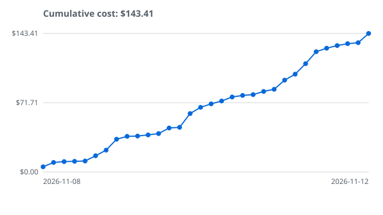

# branch-tally


**What did this pull request cost in AI-agent tokens?**

branch-tally reads an agent harness's local transcripts, assigns each recorded API call to the git
branch the work was for, and publishes a cost table on the PR. That includes work done by subagents
in git worktrees. Claude Code is the first harness supported; others follow.

> **Status: pre-alpha.** Prebuilt binaries ship on the
> [releases page](https://github.com/IAmSkweetis/branch-tally/releases), and this repository's own
> PR token reports are produced by branch-tally. Follow the
> [roadmap](https://github.com/IAmSkweetis/branch-tally/milestone/1) for progress.

## Why build branch-tally?

As I've been working on different projects, I like to keep an eye on the costs of a PR and a
project. There are not any good tools for doing this. I had found different plugins that get you
partly there. The different labs do not provide the best metrics or tools for this either.

What I had found are different projects that will give you a running token cost in a terminal. Or a
plugin or extension for different harnesses that are specific to a branch. But nothing really fit
how I think most folks are using AI in their workflows. And there is definitely a gap on a
larger project calculation.

So I had created a python script and added some instructions to a skill
to include the usage costs into my PRs.

The goal with branch-tally is to expand on this idea. And honestly, fix some bugs that I've been
putting off, too. We'll see where we get.

## What building branch-tally has cost

branch-tally records its own development. Every branch's agent usage goes into the committed ledger
(`.tally/ledger.jsonl`), and `branch-tally project` turns that ledger into a project total and a
cumulative cost-over-time chart:



The headline is the recorded project total. Each point is a branch, placed at its last recorded
call. Costs are estimates from the [price table](#price-table), and the chart covers only what the
ledger holds, so work that was never recorded is not in it. A hollow point, the dashed segment into
it, or an "at least" headline marks a figure that is a floor. The chart is a snapshot:
`just readme-graph` regenerates it.
To see the per-branch table and which calls were placed by an attribution heuristic, run
`branch-tally project` in a clone of this repository.

## Planned features

- **Per-branch and per-PR totals** of tokens and estimated cost, by model.
- **Worktree subagents rolled up** to the branch that dispatched them.
- **Honest numbers.** Usage that can't be attributed with certainty is counted and reported as
  uncertain, never dropped or guessed. A partial total is shown as a floor ("at least $X").
- **Private by design.** Only usage, model, ids, timestamps, branch and cwd are read. Message
  content never leaves your machine, and a redaction toggle hides identifiers on request.
- **Ships as** a CLI, a Claude Code plugin and skill, and a GitHub Action.

## Install

Linux (x86_64, aarch64) and macOS (Intel, Apple silicon):

```sh
curl -fsSL https://github.com/IAmSkweetis/branch-tally/releases/latest/download/install.sh | sh
```

Windows (PowerShell):

```powershell
irm https://github.com/IAmSkweetis/branch-tally/releases/latest/download/install.ps1 | iex
```

The binary goes to `~/.local/bin` (`%USERPROFILE%\.local\bin` on Windows), after the archive is
checked against the release's `SHA256SUMS`. The installers never edit your `PATH`; they print the
line to add. Their options, verifying a download by hand and building from source are in the
manual's [Installation](https://branch-tally.io/installation/) chapter.

To move to a newer release later, run `branch-tally update`. It checks the download against
`SHA256SUMS` and asks before replacing the binary.

Then, inside a repository where you have worked with Claude Code:

```sh
branch-tally report          # the current branch's token usage and estimated cost
branch-tally report --pr     # write the table into the branch's pull request
```

[Getting Started](https://branch-tally.io/getting-started.html) walks through the first report and
how to read it.

### Optional Claude Code plugins

This repository is also a Claude Code plugin marketplace with two optional plugins. Both need the
`branch-tally` binary on your `PATH`, and neither can block a session.

```text
/plugin marketplace add IAmSkweetis/branch-tally
/plugin install branch-tally-capture@branch-tally   # hooks note each session's branch
/plugin install branch-tally-record@branch-tally    # SessionEnd hook runs branch-tally record
```

`branch-tally-capture` writes an id-only `.tally/captures.jsonl` that lets reports place calls
whose transcript carries no branch. `branch-tally-record` fills the ledger before Claude Code purges
transcripts. The manual's [Claude Code](https://branch-tally.io/integration/claude-code.html) page
covers both.

Installing a plugin does not turn recording on. branch-tally never creates `.tally/`, and both
hooks write only in a repository that already has it, so opt a repository in once and commit it:

```sh
mkdir .tally
touch .tally/.gitkeep
git add .tally/.gitkeep
git commit -m "chore: opt in to branch-tally"
```

A symbolic link at `.tally` or at a file in it is refused, never followed, so a cloned repository
can't point those writes elsewhere on your machine. The manual's
[ledger page](https://branch-tally.io/ledger.html#opt-the-repository-in) has the details.

## Documentation

The user manual is at **<https://branch-tally.io/>**:

| Page | Covers |
| ---- | ------ |
| [CLI reference](https://branch-tally.io/cli.html) | Every command and flag, attribution modes, output formats, redaction, exit codes |
| [Config reference](https://branch-tally.io/config.html) | The config file: location, precedence, every key, `config show` and `config init` |
| [Persisting the Ledger](https://branch-tally.io/ledger.html) | `record` and `report --from-ledger`, to keep usage after transcripts are purged |
| [Integration](https://branch-tally.io/integration/) | Running branch-tally from an agent harness's hooks: for Claude Code, the optional plugins, how to install them and what their hooks do |
| [Hook captures](https://branch-tally.io/captures.html) | The captures file the hooks write, and how reports use it for calls the transcript could not place |
| [Workflow Examples](https://branch-tally.io/workflows/) | How this repository records each PR's token cost in a committed ledger and publishes it on the PR |

## Price table

Estimated costs come from a price table, never from numbers in the code. Every report states the
table's date and where it came from, and a model with no price is named on stderr and makes the
total an "at least" floor. The manual's
[`prices` reference](https://branch-tally.io/cli.html#branch-tally-prices-update) covers the same
ground.

The table is chosen by the first of these that exists, and that one is used whole, with no
per-model merging:

1. `.tally/prices.toml` in the repository's main checkout (the override). It must be a regular
   file in a real `.tally/` directory: a symbolic link there is refused, and stops the report.
2. The per-user cache written by `branch-tally prices update`.
3. The table built into the binary.

The cache is `branch-tally/prices.toml` under `%LOCALAPPDATA%` on Windows, `$HOME/Library/Caches`
on macOS, and `$XDG_CACHE_HOME` (default `$HOME/.cache`) elsewhere.

```bash
branch-tally prices update   # refresh the cache from LiteLLM's price list
branch-tally prices show     # which table reports would use: source, date, model count, path
```

`prices update` downloads LiteLLM's `model_prices_and_context_window.json` from GitHub, keeps the
Anthropic chat models, and replaces the cache only if the download and conversion both succeed.
It sends no account or identifying data, only a `branch-tally/<version>` User-Agent. A malformed
override or cache stops the report with a message naming the file; it is never skipped silently.

The override and cache share one TOML format. Its schema, with every key and default, is the
header of [`prices.toml`](crates/branch-tally-core/data/prices.toml), the bundled table. A minimal
override:

```toml
as_of = "2026-11-09"

[models."claude-opus-5"]
input = 5.0   # $ per million tokens
output = 25.0
```

## Links

| | |
| - | - |
| Roadmap | the [`v1` milestone](https://github.com/IAmSkweetis/branch-tally/milestone/1) |
| Project board | [branch-tally](https://github.com/users/IAmSkweetis/projects/2) |
| Contributing | [CONTRIBUTING.md](CONTRIBUTING.md): workspace setup and how a change lands |
| Code of conduct | [CODE_OF_CONDUCT.md](CODE_OF_CONDUCT.md) |
| Security | [SECURITY.md](SECURITY.md): how to report a vulnerability privately |
| Agent and project rules | [AGENTS.md](AGENTS.md) |
| Reference docs | [docs/references/](docs/references/README.md) |
| Issues | [github.com/IAmSkweetis/branch-tally/issues](https://github.com/IAmSkweetis/branch-tally/issues) |

## Licence

[MIT](LICENSE)
