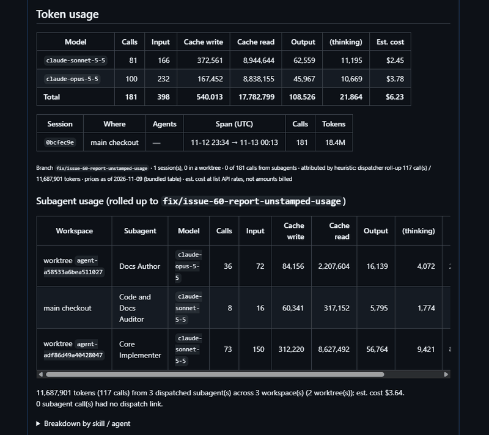

# branch-tally


branch-tally is a utility to help you track AI costs across multiple workspaces, agents and
worktrees. Claude Code is the only harness supported today. It reads local transcripts and assigns
calls to a record in a ledger. Persisting the ledger is opt-in: `branch-tally record` writes only
in a repository that has a `.tally/` directory.

The ledger only stores relevant metadata from the transcript. Prompts and messages are never
stored.

## Why build branch-tally?

As I've been working on different projects, I like to keep an eye on the costs of a PR and a
project. There are not any good tools for doing this. I had found different plugins that get you
partly there. The different labs do not provide the best metrics or tools for this either.

What I had found are different projects that will give you a running token cost in a terminal. Or a
plugin or extension for different harnesses that are specific to a branch. But nothing really fit
how I think most folks are using AI in their workflows. And there is definitely a gap on a
larger project calculation.

So I had created a python script and added some instructions to a skill
to include the usage costs into my PRs.

The goal with branch-tally is to expand on this idea. And honestly, fix some bugs that I've been
putting off, too. We'll see where we get.

## What building branch-tally has cost

branch-tally records its own development. This is to both provide an example and to be transparent
about the development costs of the project.


## PR Example Report

The way I use branch-tally is I also add a report at the end of each PR.



You can read more about this setup in the
[Workflow Examples](https://branch-tally.io/workflows/this-repository.html) in the documentation.

## Install

Linux (x86_64, aarch64) and macOS (Intel, Apple silicon):

```sh
curl -fsSL https://github.com/IAmSkweetis/branch-tally/releases/latest/download/install.sh | sh
```

Windows (PowerShell):

```powershell
irm https://github.com/IAmSkweetis/branch-tally/releases/latest/download/install.ps1 | iex
```

The binary goes to `~/.local/bin` (`%USERPROFILE%\.local\bin` on Windows), after the archive is
checked against the release's `SHA256SUMS`. The installers never edit your `PATH`; they print the
line to add. Their options, verifying a download by hand and building from source are in the
manual's [Installation](https://branch-tally.io/installation/) chapter.

To move to a newer release later, run `branch-tally update`. It checks the download against
`SHA256SUMS` and asks before replacing the binary.

Then, inside a repository where you have worked with Claude Code:

```sh
branch-tally report          # the current branch's token usage and estimated cost
branch-tally report --pr     # write the table into the branch's pull request
```

[Getting Started](https://branch-tally.io/getting-started.html) walks through the first report and
how to read it.

## Price table

Estimated costs come from a price table sourced from [LiteLLM](https://github.com/BerriAI/litellm).
The binary bundles a dated snapshot, and every report states its date. `branch-tally prices update`
caches newer prices, which take precedence, and a repository can override them. The manual's
[`prices` reference](https://branch-tally.io/cli.html#branch-tally-prices-update) provides details.

## Licence

[MIT](LICENSE)
