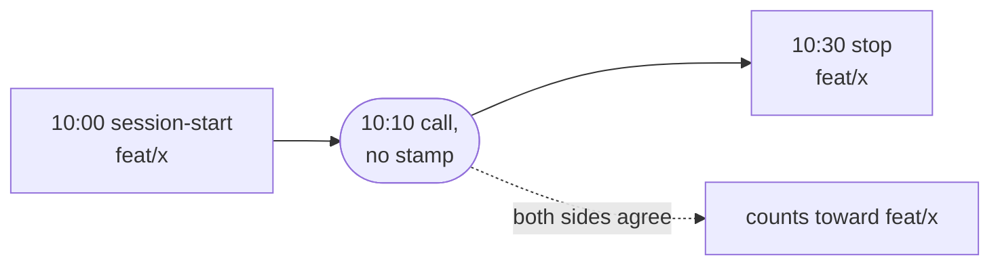

# Hook captures

A transcript stamps each API call with the git branch the session was on, but not always: some
calls carry no branch, and some carry a throwaway `worktree-agent-…` branch. In claim mode,
branch-tally recovers those calls from `git worktree list`, which only works while the worktree
still exists.

Hook captures close that gap. While a session runs, the agent harness's hooks call
`branch-tally capture`, which writes down which branch the session was on in
`.tally/captures.jsonl`. Reports read that file and use it for calls the transcript could not
place.

Claude Code is the only harness that writes captures today. To turn them on, see
[Set up captures](integration/claude-code.md#set-up-captures) on the Claude Code page.

## The captures file

`branch-tally capture` appends one JSON object per line. A synthetic example:

```json
{"v":1,"harness":"claude-code","kind":"session-start","session_id":"s1","branch":"feat/x","ts":"2026-11-11T10:00:00Z"}
{"v":1,"harness":"claude-code","kind":"subagent-stop","session_id":"s1","agent_id":"a1","branch":"feat/x","worktree_branch":"feat/x-part","ts":"2026-11-11T10:20:00Z"}
{"v":1,"harness":"claude-code","kind":"stop","session_id":"s1","branch":"feat/x","ts":"2026-11-11T10:30:00Z"}
```

| Field | Holds |
| ----- | ----- |
| `v` | The captures schema version, currently `1`. |
| `harness` | The agent harness that wrote the line. Today always `claude-code`. |
| `kind` | The hook moment: `session-start`, `subagent-stop` or `stop`. |
| `session_id` | The harness's session id. |
| `agent_id` | The subagent's id. Present on `subagent-stop` lines. |
| `branch` | The branch checked out in the session's working directory at that moment. |
| `worktree_branch` | `subagent-stop` only: the branch of the subagent's worktree, when one is found. |
| `ts` | When `capture` ran, in UTC. |

`worktree_branch` is the branch of the worktree whose directory is named `agent-<agent id>`
(compared case-insensitively). Failing that, it is the branch of the hook's own checkout, when
that checkout is a linked worktree. Otherwise it is left out, never guessed. It is stored for
later use: reports do not read it today.

`capture` writes nothing for a `SessionEnd` or `SubagentStart` payload, and nothing when the
working directory has a detached HEAD.

### Where it lives

The file is always at `.tally/captures.jsonl` in the repository's **main checkout**, even when the
session runs in a git worktree. Every session's captures land in one file, and that file outlives
the worktrees. `capture` creates `.tally/` and the file when they are missing.

Reports and `record` read it from the main checkout of the repository they run in (the `--repo`
directory, `.` by default). `--ledger` does not move it.

### What it never holds

No message content, no working directory and no path of any kind. The hook resolves its working
directory to a branch name with git, then stores only the branch. That makes the file safe to
commit, but it does hold real session ids, agent ids and branch names, and `--redact` does not
change the file. `--redact` hides identifiers in [report output](cli.md#redaction) only.

### Committing it

branch-tally treats the captures file like the [ledger](ledger.md): append-only JSON Lines, one
event per line, written with LF line endings, and merged with git's union driver. If you commit it,
add this line to your repository's `.gitattributes`, beside the ledger's:

```text
.tally/captures.jsonl merge=union
```

branch-tally does not add the line for you. Without it, two branches that both appended captures
conflict when merged.

Reports read the file from disk, so captures help on the machine that wrote them whether or not
you commit it. A capture only helps with calls in that machine's transcripts.

### Duplicates and bad lines

Two hooks racing on the same event can both write it, and a union merge can leave the same line
twice. An exact duplicate line is harmless: it is collapsed when read, and not reported.

Lines that can't be used are skipped and counted, never hidden. `report` and `record` say so on
stderr, with counts only:

```text
note: skipped 3 capture line(s) in .tally/captures.jsonl: 1 malformed, 1 unsupported version, 1 unknown kind
```

A missing file is not an error: reports run as if there were no captures.

## How captures change a report

Captures are used in **claim mode only**, the default. `--strict` and `--timeline` ignore them,
so those reports are the same with or without the file.

In claim mode a capture can place a call only when all of these hold:

- the call was made by the session itself, not by a subagent. A subagent's calls still go to the
  branch of the session that dispatched them (*dispatcher roll-up*);
- the call's transcript stamp is missing or a `worktree-agent-…` branch. A real branch stamp is
  never overridden;
- the session's captures **bracket** the call's time and agree on one branch.

"Bracket" means: take the session's last capture at or before the call and its first capture at
or after it (every capture sharing that instant, on each side). **Both sides are required.** If
every one of those names the same branch, the call gets that branch. A capture of a
`worktree-agent-…` branch, a detached `HEAD` or an empty branch never counts as agreement.



Had the `stop` at 10:30 named `main`, the captures would disagree and the call would get nothing
from them.

A call with captures on **one side only** gets nothing from them either. Say a session starts on
`feat/x`, you check out `feat/y`, and the agent makes a call. If the report runs before the next
`stop` capture is written, or that capture failed, only the 10:00 `feat/x` capture comes before the
call, and nothing comes after it to confirm the branch had not changed. So the captures don't
vouch for the call, even if every capture in the session names `feat/x`.

A bracket still can't see everything between its two captures. If both sides name `feat/x`, the
session could have switched to `feat/y` and back to `feat/x` in between, and the call would still
count toward `feat/x`. The `stop` hook fires at the end of every turn, so the window is usually a
single turn, and longer only when a capture failed. A call placed this way is a close inference,
not a certainty, and that is why the report lists it as a heuristic (see
[What the report says](#what-the-report-says)).

When the captures don't settle a call, nothing is guessed. The call goes through the same recovery
as it would without captures (worktree recovery and origin recovery from `git worktree list`), and
is as uncertain as it was before. When the captures do settle it, they win over that recovery,
since they were written while the work happened.

### What the report says

Calls placed by captures are a heuristic, and the report names it like the others. The Markdown
footnote's list of heuristics gains an entry:

```text
captured hook data N call(s) / M tokens
```

The JSON output's `heuristics` object gains `captured`, with `calls` and `tokens`. Both appear only
when at least one call was placed by a capture, so a report that used no captures looks exactly as
it did before.

`record` stores the basis with each ledger line, as `captured`, so a report from the
[ledger](ledger.md) shows the same heuristic.
