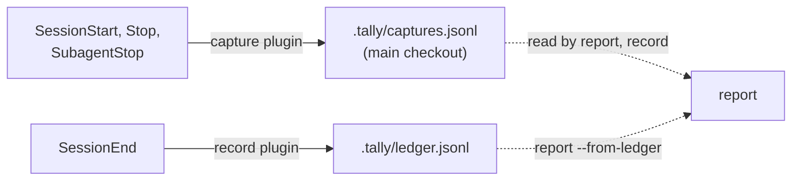

# Claude Code

branch-tally reads Claude Code's transcripts with no setup. This page covers the optional part:
running branch-tally from Claude Code's own hooks.

branch-tally's repository is also a Claude Code plugin marketplace. It offers two optional plugins
that run branch-tally from Claude Code hooks, so the numbers keep working after Claude Code purges
old transcripts and after worktrees are removed.

| Plugin | Runs on | Runs | Gives you |
| ------ | ------- | ---- | --------- |
| `branch-tally-capture` | `SessionStart`, `SubagentStop`, `Stop` | `branch-tally capture` | A record of which branch each session was on, so calls whose transcript stamp is missing can still be attributed. See [Set up captures](#set-up-captures). |
| `branch-tally-record` | `SessionEnd` | `branch-tally record` | The [ledger](../ledger.md) filled in at the end of every session, before the transcripts can be purged. |

They are separate plugins so you can install, disable or remove each one on its own. Claude Code
can turn off a whole plugin but not one hook inside it.

## Before you install

- **Install the binary first.** Both plugins call `branch-tally` by name, so it must be on the
  `PATH` that Claude Code's hooks see. See [Installation](../installation/). Without it
  the hooks do nothing.
- **Start Claude Code inside the repository.** The hooks run in the session's working directory.
  In a directory that is not a git checkout they find nothing to record.
- **Opt the repository in.** Installing a plugin does not turn recording on. The hooks write only
  in a repository that already has a `.tally/` directory, and they never create it. Create and
  commit it once, from the repository's root:

  ```sh
  mkdir .tally
  touch .tally/.gitkeep
  git add .tally/.gitkeep
  git commit -m "chore: opt in to branch-tally"
  ```

  In a repository without it, both hooks write nothing and exit 0: `capture` prints nothing, and
  `record` prints only `no .tally/ directory: nothing recorded (create it to opt in)`. See
  [Opt the repository in](../ledger.md#opt-the-repository-in).

## Install

In Claude Code, add the marketplace once, then install the plugins you want:

```text
/plugin marketplace add IAmSkweetis/branch-tally
/plugin install branch-tally-capture@branch-tally
/plugin install branch-tally-record@branch-tally
```

Install either one, both, or neither. To stop one later, disable or uninstall it:

```text
/plugin disable branch-tally-record@branch-tally
/plugin uninstall branch-tally-record@branch-tally
```

### For everyone who works in a repository

To turn the plugins on for a whole team, declare the marketplace and enable the plugins in the
repository's `.claude/settings.json` and commit it. branch-tally's own repository does this:

```json
{
  "extraKnownMarketplaces": {
    "branch-tally": {
      "source": {
        "source": "github",
        "repo": "IAmSkweetis/branch-tally"
      }
    }
  },
  "enabledPlugins": {
    "branch-tally-capture@branch-tally": true,
    "branch-tally-record@branch-tally": true
  }
}
```

Claude Code applies a marketplace declared this way only after each person trusts the folder. See
the [Claude Code settings documentation](https://code.claude.com/docs/en/settings) for the rules.
Everyone still needs the `branch-tally` binary installed.

## What the hooks do



Both hooks write only into a `.tally/` directory that already exists (see
[Before you install](#before-you-install)), and never through a symbolic link (see
[Symbolic links are refused](../ledger.md#symbolic-links-are-refused)).

**`branch-tally-capture`** runs `branch-tally capture` when a session starts, when a subagent
finishes and when the main agent stops. Each run appends one line to `.tally/captures.jsonl` in the
repository's main checkout: the session id, the agent id for a subagent, the branch, the kind of
event and the time.

**`branch-tally-record`** runs `branch-tally record` when a session ends. That appends the current
branch's attributed usage to `.tally/ledger.jsonl`, exactly as running `record` by hand would:

- It records the branch that the session's directory has checked out when the session ends, in the
  attribution mode from your [config file](../config.md) (`claim` by default).
- The ledger it writes is at the root of the checkout the session ran in. A session in a git
  worktree writes the worktree's own ledger, which merges back with the worktree's branch. That
  needs `.tally/` in the worktree's own checkout, which it has when the directory is committed.
- It writes the file only. It does not `git add` or commit. Commit the ledger yourself, as
  described in [Persisting the Ledger](../ledger.md).
- It is safe to run every session. `record` appends only the calls the ledger does not already
  hold.

## Set up captures

[Hook captures](../captures.md) describes the captures file, where it lives and how reports use
it. In Claude Code, captures come from three hooks: `SessionStart`, `SubagentStop` and `Stop`. Each
runs `branch-tally capture`, which reads the hook payload Claude Code passes on stdin.

1. Install the `branch-tally-capture` plugin, as shown in [Install](#install). It sets up all
   three hooks.

   To use your own settings file instead of the plugin, add the same three hooks to it. This is
   what the plugin installs:

   ```json
   {
     "hooks": {
       "SessionStart": [
         {
           "hooks": [
             { "type": "command", "command": "branch-tally capture; exit 0", "timeout": 30 }
           ]
         }
       ],
       "SubagentStop": [
         {
           "hooks": [
             { "type": "command", "command": "branch-tally capture; exit 0", "timeout": 30 }
           ]
         }
       ],
       "Stop": [
         {
           "hooks": [
             { "type": "command", "command": "branch-tally capture; exit 0", "timeout": 30 }
           ]
         }
       ]
     }
   }
   ```

   Keep the `; exit 0`. It is what stops a failed capture from blocking `Stop` or `SubagentStop`
   (see [The hooks never block a session](#the-hooks-never-block-a-session)).

2. Opt the repository in by creating and committing `.tally/`, as shown in
   [Before you install](#before-you-install). Without it, `capture` writes nothing.

3. Start Claude Code in the repository and work as usual. The first capture creates
   `captures.jsonl` inside the main checkout's `.tally/`.

4. If you commit the file, add `.tally/captures.jsonl merge=union` to your `.gitattributes`, as
   described in [Committing it](../captures.md#committing-it).

Captures help reports in claim mode, the default, and only for calls the transcript could not
place. [How captures change a report](../captures.md#how-captures-change-a-report) gives the exact
rules.

## The hooks never block a session

Every hook command ends in `; exit 0`, for example `branch-tally capture; exit 0`. That works in
both Bash and PowerShell, and it means a hook always exits 0, whatever happened: a missing binary,
a directory that is not a repository, a detached HEAD, a branch with no usage yet, a refused
symbolic link in `.tally/`, or a usage error. Claude Code never sees a failure and never blocks
`Stop` or `SubagentStop`.

The three capture hooks each set a 30-second `timeout`. The record hook sets none, because a
plugin can't change how long `SessionEnd` gets. That limit is covered next.

## SessionEnd time limit

Claude Code gives `SessionEnd` hooks 1.5 seconds by default. A `timeout` on a hook that a plugin
provides does not raise that budget. Only a `timeout` in your own settings files, or an environment
variable, does. `branch-tally record` reads all of the repository's transcripts, so a long history
can take longer than 1.5 seconds. To give it more time, do one of these:

- Set `CLAUDE_CODE_SESSIONEND_HOOKS_TIMEOUT_MS`, in milliseconds, before you start Claude Code. For
  example, `CLAUDE_CODE_SESSIONEND_HOOKS_TIMEOUT_MS=10000 claude` allows 10 seconds. This needs
  Claude Code v2.1.268 or later. Before that, the variable raised only the overall budget, and a
  hook with no `timeout` of its own, like the record plugin's, was still stopped after 1.5 seconds.
- Add your own `SessionEnd` hook that runs `branch-tally record; exit 0` with a `timeout` (up to 60
  seconds) in your settings file, instead of installing the record plugin.

These rules belong to Claude Code, not branch-tally. Check the `SessionEnd` section of the
[Claude Code hooks reference](https://code.claude.com/docs/en/hooks) for the current behaviour.

If Claude Code stops `record` before it finishes, the usage it missed can still be recorded.
`record` appends only the calls the ledger does not already hold, so the next `SessionEnd`, or a
`branch-tally record` you run by hand, writes the rest, provided it runs before the transcripts are
purged. If the stop cut the ledger's last line short, reports skip that
line, count it as malformed in a `note: skipped N ledger line(s)` message on stderr, and carry on.
The next `record` starts on a fresh line and writes the cut entry again whole. Until it does, a
report from the ledger is missing that call. The total is then lower than the real cost, but the
report does not label it "at least" for this reason: the stderr note is the signal.

## Which shell runs the hooks

Claude Code runs each hook command through a shell: `sh -c` on macOS and Linux, Git Bash on
Windows, or PowerShell on Windows when Git Bash is not installed. `; exit 0` works in all of them.
If you copy a hook into your own settings, its `shell` field (`"bash"` or `"powershell"`) picks one
explicitly.

An error can still print a line on stderr. `branch-tally capture` prints one short fixed message
and never echoes the payload or the working directory. A refused link, for example, prints
`capture: refusing to write: .tally/ or its captures file is a symlink or not a regular file`.

## Privacy

The hooks read only the hook payload Claude Code passes on stdin. `capture` reads its session id,
event name, agent id, agent type and working directory, and ignores every other field. It stores
no path: it asks git which branch the working directory is on and keeps only the branch name.
`record` stores what the [ledger](../ledger.md#what-is-stored) stores. Neither writes message
content.

Both files are designed to be committed, so anyone who can read the repository can read the
session ids, agent ids and branch names in them.
