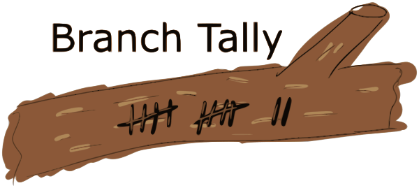
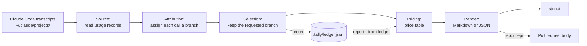

# Overview

**What did this branch or pull request cost in AI-agent tokens?**

branch-tally answers that question. It reads the transcripts an AI coding agent writes on your
machine, assigns each recorded API call to the git branch the work was for, and prints a cost table
for that branch. It can also write the table into the branch's pull request. That includes work
done by subagents running in git worktrees.

Claude Code is the agent harness supported today. branch-tally ships as a command-line tool for
Linux, macOS and Windows, plus two optional Claude Code plugins whose hooks keep its numbers intact
after transcripts are purged (see [Claude Code integration](integration/claude-code.md)).

> **Status: pre-alpha.** The flags, output and ledger format may still change between releases.
> Follow the [roadmap](https://github.com/IAmSkweetis/branch-tally/milestone/1) for what is planned.

## The problem

Claude Code records every API call in local transcript files, with its token usage, the model and
the git branch the session was on. It does not tell you what a branch cost. A single session often
touches several branches. Subagents dispatched into worktrees record their calls under the session
that dispatched them, often stamped with a throwaway branch name. Transcripts are deleted after a
retention period (Claude Code's `cleanupPeriodDays`, 30 days by default).

branch-tally does the bookkeeping: it finds the transcripts for a repository, decides which calls
belong to the branch you ask about, adds up the tokens per model, and estimates the cost from a
price table.

## Honest numbers

A cost table is only useful if it says what it could not see. branch-tally holds itself to that:

- **Uncertain usage is counted and reported, never dropped or guessed.** When calls can't be
  assigned to a branch with certainty, the report says how many, and the token total is labelled
  "at least". Calls in the repository that carry no branch stamp and can't be placed on any branch
  are counted in their own line, never put on a branch to make the numbers add up.
- **Heuristics are named.** When a call was assigned to the branch by a heuristic, such as the
  session that claimed it or the dispatcher a subagent rolled up to, the report's footnote lists
  each heuristic with its call and token counts.
- **Unpriced models make the total a floor.** A model missing from the price table shows `—` as its
  cost, is named in a warning on stderr, and the total reads "at least $X".
- **Skipped input is announced.** Malformed transcript lines, records without a request id and
  synthetic records are counted in a note on stderr.
- **Costs are estimates.** They are computed at list API rates from a dated price table, and the
  report says which table and which date. They are not the amounts you were billed.

## Privacy

Transcripts hold your prompts, your code and sometimes secrets. branch-tally reads only the fields
it needs: token usage, model, ids, timestamps, branch, working directory and the subagent dispatch
link. **Message content is never read into output.** It does not appear in the report, in the
[ledger](ledger.md), in the [hook captures](captures.md) file, in error messages or in anything
sent to GitHub.

Reports do show session ids, agent and skill names, worktree names and timestamps. `--redact` hides
those identifiers in the output (see the [CLI reference](cli.md#redaction)). The only network calls
branch-tally makes are `prices update`, which downloads a public price list, `update`, which asks
the GitHub API for the latest release and downloads a branch-tally release, and `report --pr`,
which runs the GitHub CLI (`gh`) to edit your pull request.

## How it works

Each stage consumes only the one before it.

To zoom a diagram, use the + and − buttons in its corner, or hold Ctrl (Cmd on macOS) and turn the
mouse wheel. Once it is zoomed in, drag to pan, and the reset button returns it to normal size.

- **Source** reads the transcript files for the repository and its worktrees, and keeps only usage
  records.
- **Attribution** assigns each call a branch, including subagent calls rolled up to the branch
  of the session that dispatched them. The three attribution modes are described in the
  [CLI reference](cli.md#attribution-modes).
- **Selection** keeps the calls for the branch you asked about. `record` writes those to the
  [ledger](ledger.md), and `report --from-ledger` reads them back in place of the live
  transcripts.
- **Pricing** applies the price table.
- **Render** prints the Markdown table or JSON, and `report --pr` splices it into the pull request.

## Where to go next

- [Getting Started](getting-started.md): install, run your first report and read it.
- [Persisting the Ledger](ledger.md): keep usage after transcripts are purged, and combine
  machines.
- [Integration](integration/): run branch-tally from your agent harness's hooks. For
  Claude Code, two optional plugins capture each session's branch and fill the ledger for you.
- [CLI reference](cli.md) and [Config reference](config.md): every flag and key.
