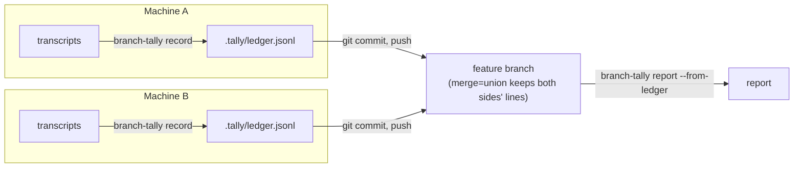
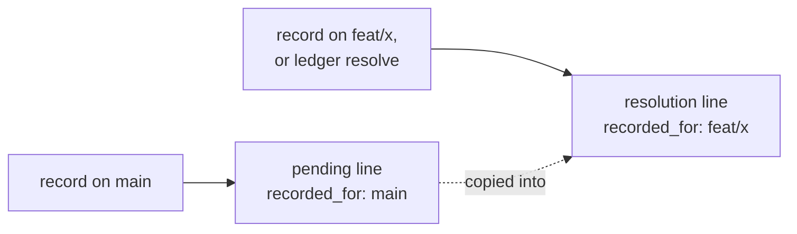

# Persisting the Ledger

By default `branch-tally report` reads Claude Code's transcripts live. That has limits:

- **Transcripts are purged.** Claude Code deletes them after `cleanupPeriodDays` (30 days by
  default). A branch that took longer than that, or a report run after the cleanup, comes up
  short.
- **Transcripts are local.** Work on a branch often happens on more than one machine. Each machine
  only sees its own sessions.
- **Worktrees come and go.** Subagent work in a git worktree is easiest to attribute while the
  worktree still exists.

The ledger fixes that. `branch-tally record` writes a branch's attributed usage to a file in the
repository, `.tally/ledger.jsonl`. You commit that file like any other. `branch-tally report
--from-ledger` then reports from it, with or without the transcripts.



## Set up your repository

### Opt the repository in

branch-tally never creates `.tally/`. `record` and the [hook captures](captures.md) write only when
the directory already exists as a real directory, so a repository opts in by having one. Create it
once, from the repository's root, and commit it:

```sh
mkdir .tally
touch .tally/.gitkeep
branch-tally ledger redact     # creates .tally/salt; there is nothing to rewrite yet
git add .tally/.gitkeep .tally/salt
git commit -m "chore: opt in to branch-tally"
```

Git does not track empty directories, which is what the `.gitkeep` is for. Once the ledger itself
is committed, it keeps the directory in place on its own.

`.tally/salt` is the key `record` hashes ids with, which it does by default. Every clone must use
the same one, so it is committed. `record` would create it the first time it appends a line, but
creating it here, once, keeps two machines from each creating their own. What it protects, and what
it does not, is on the [Ledger Redaction](ledger-redaction.md) page.

Committing the directory matters because every clone and every git worktree gets its own copy of
it. A worktree, or a clone, whose checked-out commit has no `.tally/` is not opted in, and `record`
writes nothing there. [Hook captures](captures.md) always go to the main checkout's `.tally/`, so
the main checkout needs the directory too. A worktree that opted in on its own branch still
captures nothing while the main checkout is on a branch without `.tally/`. Commit the opt-in to the
default branch, so every branch cut from it has the directory.

Without the directory, `record` writes nothing, creates nothing, prints this on stdout and exits 0:

```text
no .tally/ directory: nothing recorded (create it to opt in)
```

`--ledger <path>` is exempt only with redaction off: an explicit ledger file is then written whether
or not `.tally/` exists. With redaction on, the default, the salt has to live in the main
checkout's `.tally/`, so `record --ledger <path>` without it is an error (exit 1). See
[An explicit `--ledger` needs `.tally/`](ledger-redaction.md#an-explicit---ledger-needs-tally).

### Keep both sides' lines on merge

Add this line to your repository's `.gitattributes`:

```text
.tally/ledger.jsonl merge=union
```

`merge=union` tells git to keep both sides' lines when two branches have each appended to the
ledger, instead of reporting a conflict. branch-tally does not add this line for you. Without it,
two branches that both recorded will conflict when merged.

If you use a different path with `--ledger`, put that path in `.gitattributes` instead.

If you commit the [hook captures](captures.md) file too, give it the same treatment:
`.tally/captures.jsonl merge=union`.

Don't give `.tally/salt` that treatment, and don't use a pattern such as `.tally/* merge=union`
that would include it. The salt is one line. A union merge of two different salts would leave two
lines, which is not a valid salt, and `record` would stop. A conflict there is meant to be loud;
see [The salt](ledger-redaction.md#the-salt).

## Record

```sh
branch-tally record              # the current branch
branch-tally record feat/thing   # a named branch
```

`record` selects the branch's usage exactly as `report` would, then appends one line per API call
to the ledger:

```text
appended 3, skipped 0, branch feat/x
```

- **It only writes the file.** It does not `git add` or commit anything. Commit the ledger
  yourself.
- **It hashes identifiers.** By default the request, session and agent ids, worktree names and
  the id in a `worktree-agent-<id>` branch name are written as keyed hashes, and each line carries
  a `redaction` field. Other branch names, models, token counts and times are written as they
  are. `--no-ledger-redact` writes raw ids. See
  [Ledger Redaction](ledger-redaction.md).
- **It is safe to run again.** Each line is keyed by the API call's request id and the branch it
  was recorded for. `record` appends only keys the ledger does not hold yet, so a second run
  reports `appended 0, skipped 3`.
- **It creates the file, not the directory.** In an [opted-in](#opt-the-repository-in) repository
  it creates `ledger.jsonl` inside `.tally/` when the file is missing. It never creates `.tally/`
  itself.
- **It stores the mode.** `record` takes the same `--mode`, `--strict`, `--timeline` and
  `--work-branch` options as `report`, and the [config file](config.md)'s `mode` and
  `work-branch`. Each line stores the mode it was selected under.
- In claim mode, one API call can count toward two branches. It is then recorded once for each
  branch you record.
- **On the default branch, its lines are pending.** Usage recorded for the repository's default
  branch is written with `"pending": true`, and `record` on any other branch then tries to resolve
  it. See [Usage recorded on the default branch](#usage-recorded-on-the-default-branch).

Run `record` on every machine that did work on the branch, **before** its transcripts are purged,
and while any worktrees the work used still exist. Then commit and push the ledger.

The full option list is in the [CLI reference](cli.md#branch-tally-record).

## Record automatically when a session ends

Remembering to run `record` before `cleanupPeriodDays` runs out is easy to get wrong. The optional
`branch-tally-record` Claude Code plugin does it for you: its `SessionEnd` hook runs
`branch-tally record` every time a session in the repository ends.

```text
/plugin marketplace add IAmSkweetis/branch-tally
/plugin install branch-tally-record@branch-tally
```

The hook records the branch the session's directory has checked out when the session ends, with
the `mode` and `work-branch` from your [config file](config.md). It is the same command as above,
so the same rules hold: it writes only in a repository that has
[opted in](#opt-the-repository-in), it only writes the file, a second run appends nothing new, and
you still commit and push the ledger yourself. Installing the plugin does not opt a repository in.
It needs `branch-tally` on your `PATH`, and it never blocks the session, even when `record` fails.

Claude Code gives a `SessionEnd` hook 1.5 seconds by default, and a plugin can't raise that.
`record` reads every transcript for the repository, so a long history can need more. Set
`CLAUDE_CODE_SESSIONEND_HOOKS_TIMEOUT_MS` (in milliseconds) or use a hook in your own settings with
a `timeout`, as described in
[SessionEnd time limit](integration/claude-code.md#sessionend-time-limit). If `record` is stopped
part way, it catches up later: it appends only what the ledger does not already hold, so the next
session end, or a `record` by hand, writes the rest, provided it runs before the transcripts are
purged.

A branch worked on from several sessions, or with sessions that ended on another branch, may
still need a `record` by hand for the branches the hook did not see. Installing the plugin, and
the companion `branch-tally-capture` plugin, is covered on the
[Claude Code integration](integration/claude-code.md) page.

## Usage recorded on the default branch

Work often starts on the default branch and moves to a branch cut partway through. A session that
plans on `main` and then runs `git checkout -b feat/x` has made calls stamped `main` that were
really for `feat/x`. If the record hook runs while `main` is checked out, those calls are recorded
for `main`, and branch-tally can't yet tell which branch, if any, they were for.

So `record` doesn't treat them as `main`'s usage. When the branch it records is the repository's
default branch, every line it writes carries `"pending": true`, and it says so on stderr:

```text
appended 2, skipped 0, branch main
note: 2 pending line(s) written: usage is uncertain until a branch is cut and resolved
```

The default branch is the one `origin/HEAD` points to, then git's `init.defaultBranch`, and
otherwise `main`. What decides it is the branch being recorded, not the one checked out:
`record main` from another branch writes pending lines too.

A pending line otherwise says exactly what `record` saw: its `recorded_for` and `branch` are still
the default branch. It is never edited afterwards. Instead, once the evidence shows which branch
the call was for, a **resolution line** is appended: a copy of the pending line, recorded for that
branch, with `"resolved": {"from": "main"}`.



### Resolving pending lines

Resolution happens in two places, and in both it only resolves lines to **one branch**: the
current branch, or the one named.

- **Automatically, at the end of `record`** on any branch other than the default. After appending
  the branch's own lines, `record` resolves the pending lines that belong to that branch. The
  [record plugin](integration/claude-code.md) runs `record` at every session end, so pending lines
  are resolved the next time a session on that machine ends with their branch checked out.
- **By hand, with [`branch-tally ledger resolve`](cli.md#branch-tally-ledger-resolve)**, which does
  only the resolving. Add `--dry-run` to see the counts first:

  ```sh
  branch-tally ledger resolve --dry-run   # count, write nothing
  branch-tally ledger resolve             # append the resolutions for the current branch
  branch-tally ledger resolve --branch feat/x
  ```

  ```text
  resolved 2, covered 0, left for another branch 1, branch feat/x
  ```

There is no way to resolve every branch at once. A pull request carries resolutions for its own
branch only. `ledger resolve` on the default branch prints
`on the default branch: nothing to resolve` and writes nothing.

The evidence is read from this machine's live transcripts and [hook captures](captures.md). A
capture is used only for a call whose transcript is still there, so resolve before the transcripts
are purged:

- **The session's timeline.** branch-tally follows the session's branch over time, as
  [timeline mode](cli.md#attribution-modes) does. A call made on the default branch before the
  session's first work branch goes to the work branch the session moved to next. A subagent's call
  goes to the branch its dispatcher was on when it dispatched it. Here a work branch is any branch
  except the default branch and `worktree-agent-*`. `--mode`, `--work-branch` and the config file
  don't change this.
- **The hook captures.** The session's first capture at or after the call that names a work
  branch. Captures at that same instant must all name the same branch.

The resolution line's `basis` names the evidence used: `timeline-forward` (the session's
timeline), `dispatcher-rolled-up` (a subagent) or `captured` (a hook capture). Its `kept_by` is
`exact`. When both kinds of evidence exist and they name different branches, the line is not
resolved.

Each pending line ends up in one of these outcomes, which `record` and `ledger resolve` count:

| Outcome | What happens |
| ------- | ------------ |
| resolved | The evidence places the call on this branch. A resolution line is appended. |
| covered | The ledger already holds an ordinary line for the same call on another branch, or a resolution to this one. Nothing is appended. |
| left for another branch | The evidence places the call on a different branch. Nothing is appended; it can be resolved from that branch. |
| left unresolved | The call can't be placed with certainty. It stays pending. See below. |

*Covered* is common in claim mode. A [session claim](cli.md#attribution-modes) counts a session
that started on `main` and moved to `feat/x` entirely toward `feat/x`, so `record` on `feat/x`
writes its own lines for those early calls. The pending lines for them are then already covered,
and no resolution line is needed.

`record` prints the counts on stderr, only when there was a pending line to consider:

```text
note: resolved 2 pending line(s), 0 already covered, 1 left for another branch
```

### What stays pending

branch-tally does not guess. A pending line that can't be placed with certainty stays pending, is
counted, and is reported as uncertain. `record` and `ledger resolve` print the count with a reason
for each:

```text
note: 3 pending line(s) left unresolved, usage uncertain (1 no timestamp, 2 no work branch cut)
```

| Reason | Why the line stays pending |
| ------ | -------------------------- |
| `no timestamp` | The line has no `ts`, so it can't be placed in the session's timeline. |
| `no evidence` | No transcript for the call was found on this machine, because it was purged or the work was done on another machine, or no salt here matches the line's [redaction](ledger-redaction.md#pending-and-resolution-lines). |
| `ambiguous` | Records at the same instant were on conflicting work branches. |
| `no work branch cut` | The session never moved to a work branch, and no capture names one. |
| `subagent not linked to a dispatch` | A subagent's call that can't be tied to the session that dispatched it. |
| `returned to the default branch` | The session went back to the default branch after a work branch. The call is never assigned back to that earlier branch. |
| `transcripts and captures disagree` | The timeline and the captures name different branches. |
| `resolved to another branch` | The call is already resolved to a different branch. |

Leaving a line unresolved is not an error: `record` and `ledger resolve` still exit 0. A line can
stay pending for good, for example a call made on `main` for work that never got a branch. It is
then counted as pending in every report, never added to a branch.

### Pending usage in reports

A pending line is in no branch's totals, the default branch's included: `report main --from-ledger`
and the [`project`](project.md#pending-usage) report leave it out. A resolution line is an ordinary
line for its branch, so once resolved, the call counts toward that branch. A live report counts
calls from the transcripts, not from ledger lines, so what it counts for a branch is what
attribution assigns now.

Unresolved pending lines are reported beside the totals instead. They are counted across the whole
ledger, once per call, whichever branch the report is for. A call the report already counts in its
totals is left out of the pending count, so nothing is counted twice: for example an early call
that claim or timeline mode attributes to the branch before it is resolved, or a call a live report
for `main` counts from its transcript. So the pending count can differ from one report to the
next. The Markdown report adds a line after the footnote, for example:

```text
<sub>1 pending ledger line(s), 1 call(s) / 600 tokens, were recorded on the default branch and could not yet be attributed to a branch with certainty; they are not in these totals.</sub>
```

The JSON report has a top-level `pending` object:

```json
"pending": { "lines": 1, "calls": 1, "tokens": 600 },
```

Both are left out when there are no unresolved pending lines. A live `report` reads them from the
checkout's default ledger, `.tally/ledger.jsonl`, and shows none when there isn't one. If that
ledger exists but can't be read, the report still prints and says so on stderr:
`note: the ledger could not be read, so pending usage is unknown and not in this report`.

Some of the pending usage may belong to the branch being reported, so a total beside it is partial.
When there are unresolved pending lines, the total cost reads "at least" and the JSON sets
`totalCostIsFloor` to `true`.

A report that counts no calls but finds unresolved pending lines is still printed, live or from
the ledger, with or without `--with-live`. Its totals are zero and the pending line says how much
usage is waiting. That is the usual result of `report main --from-ledger` when every line for
`main` is pending:

```text
| **Total** | **0** | **0** | **0** | **0** | **0** | **0** |
```

Only when there are no calls and no unresolved pending lines does `report` fail with "no records"
(see [Common errors](cli.md#common-errors)).

### Upgrade the checker with the binary

Pending lines are still recorded for the default branch. A
[`ledger check`](#checking-ledger-changes) from a release without pending lines doesn't know the
`pending` field, so it fails them as
`recorded for the base branch`. When you upgrade the branch-tally that records, upgrade the binary
your CI runs `ledger check` with at the same time.

The reverse also holds: an older `record` writes plain lines for `main`, not pending ones, and the
current check still fails those.

## Report from the ledger

```sh
branch-tally report --from-ledger
branch-tally report --from-ledger --with-live
```

`--from-ledger` reports only from the ledger's lines recorded for the requested branch. It works
on a machine with no transcripts at all, such as a fresh clone. Every other `report` option still
applies: `--json`, `--pr`, `--redact` and the rest, with the same rules as a live report. For
example, `--json` with `--pr` is a command-line error (exit 2), because the PR body is always
Markdown. See [Conflicting flags](cli.md#conflicting-flags).

`--with-live` also reads this machine's live transcripts and combines them with the ledger. When a
call appears in both, the ledger's line is used, so nothing is counted twice. Use it when part of
the work is recorded and part is still only in local transcripts. `--with-live` without
`--from-ledger` is a command-line error (exit 2).

Prices are applied when you report, not when you record. The ledger stores token counts, so a
report from the ledger uses the price table in effect at report time.

What a ledger report tells you on stderr, as counts only:

| Note | Meaning |
| ---- | ------- |
| `note: unattributed counts unavailable from the ledger` | A live report can say how many calls in the repository could not be attributed to any branch: the [unstamped calls](cli.md#unstamped-calls) line (the JSON `unstamped` key) and the subagent section's unattributed counts. The ledger only holds the requested branch's calls, so it can't, and those counts are left out. With `--with-live` they come from the live transcripts and the note is not printed. |
| `note: ledger mixes modes (claim, timeline); the numbers combine them` | The branch was recorded under more than one attribution mode. |
| `note: skipped N ledger line(s): …` | Lines that were malformed or written by an unsupported ledger version were skipped and counted. |
| `note: N record(s) had an unreadable timestamp; they were kept but are undated` | Ledger lines whose `ts` is not strict RFC 3339 (see [Timestamps](cli.md#timestamps)). The lines are used and counted, but treated as having no timestamp. With `--with-live`, a separate line of the same form counts the live transcripts' records. |
| `note: ledger holds N unredacted line(s) and M redacted line(s) under K salt(s); a call recorded in more than one form may be counted twice…` | The ledger mixes raw and hashed lines, or lines hashed under more than one salt. A call recorded in both forms is counted twice. Also printed by `project`. `report` and `project` also state it in the output, in a bold "Total may count some calls twice" line and the JSON `doubleCount` key. See [Mixed ledgers](ledger-redaction.md#mixed-ledgers). |
| `note: live calls could not be matched against the redacted ledger lines (…); the total and the repository-wide counts may count a call twice` | With `--with-live`: the local salt is missing, unreadable, or doesn't match the ledger's redacted lines, so a call in both may be counted twice. The report states it too, as above. See [Combining the ledger with live transcripts](ledger-redaction.md#combining-the-ledger-with-live-transcripts). |
| `note: N ledger line(s) held the same call under both the raw and hashed spelling of an agent branch and were counted once` | The same stored request id appears under both spellings of a `worktree-agent-<id>` branch, raw and hashed: for example, a line with hashed ids whose branch an earlier build left raw. It is counted once. A call recorded once raw and once redacted has two different request ids, so it is not collapsed here: that is a [mixed ledger](ledger-redaction.md#mixed-ledgers), counted twice and noted. See [Ledger Redaction](ledger-redaction.md#what-a-committed-ledger-makes-public). |
| `note: N ledger request(s) had conflicting lines; kept the latest` | Printed only with `--allow-ledger-conflicts`. Two lines with the same key held different data, and the one with the latest `recorded_at` was used. See [Conflicting ledger lines](#conflicting-ledger-lines). |

A duplicate line, such as one left by a union merge or by recording twice, is collapsed silently:
it is not a conflict.

### Conflicting ledger lines

Each line is keyed by its `request_id` and `recorded_for`. A conflict is two lines with the same
key and different contents. It is unusual, because `record` skips a key the ledger already holds,
so it can mean a line was edited or added by hand. Which line wins decides what that call costs,
so by default a conflict stops the run. `report --from-ledger` and `project` exit with status 3 and
print a count, never a request id or line text:

```text
error: 1 ledger request(s) have conflicting lines, so the reported cost depends on which line wins. Inspect the ledger, or pass --allow-ledger-conflicts to proceed with the latest line for each
```

Look at the ledger's history (`git log -p -- .tally/ledger.jsonl`) to find out where the extra line
came from, and remove the wrong one. To report anyway, pass `--allow-ledger-conflicts`. The line
with the latest `recorded_at` is then used for each key, and the count is still printed on stderr
as `note: N ledger request(s) had conflicting lines; kept the latest`.

If both conflicting lines are already on your base branch, a pull request that removes one fails
[`ledger check`](#checking-ledger-changes), because base lines may only be appended to. That repair
is the one change that has to bypass the check: open a pull request that removes the wrong line,
say why in its description, and merge it with whatever bypass your repository's rules allow, so the
exception is recorded on the pull request. A pull request can't add a new conflict past the check,
which fails a new line that repeats a key the base holds or that conflicts with an earlier new
line.

Exit 3 is separate from the general failure status, 1. A script that runs `report --from-ledger`
or `project` and tests only for exit 1 should test for any non-zero status instead.

If the ledger has no lines for the branch, and no unresolved pending lines either,
`report --from-ledger` fails with `No ledger records found for branch '…'` (exit 1). With
unresolved pending lines it prints a report with zero totals and the pending line instead (see
[Pending usage in reports](#pending-usage-in-reports)). If the ledger file, or the `.tally/`
directory, does not exist, it fails with `no ledger at <path>` (exit 1). A linked default ledger
is refused (see [Symbolic links are refused](#symbolic-links-are-refused)).

## The whole project

`branch-tally project` reads the whole ledger and reports every recorded branch at once: the
project total, a row per branch, and a chart of cumulative cost over time. See
[Project Cost Over Time](project.md).

## Where the file lives

The default is `.tally/ledger.jsonl` at the root of the git checkout that contains the current
directory (or the `--repo` directory). Run from inside a git worktree, that is the worktree's own
root, so the ledger is committed on the worktree's branch and merges back with it. `record` writes
there only when that checkout has a `.tally/` directory: see
[Opt the repository in](#opt-the-repository-in).

`--ledger <path>` uses another file, on both `record` and `report --from-ledger`. Outside a git
checkout, `--ledger` is required: without it, `record` and `report --from-ledger` fail (exit 1)
rather than write a stray ledger.

On `report`, `--ledger` needs `--from-ledger`: without it the command line is wrong (exit 2).

### Symbolic links are refused

`.tally/` is part of the repository, and git can store a symbolic link. A cloned repository could
therefore ship `.tally/ledger.jsonl`, or `.tally` itself, as a link to a file somewhere else on
your machine, and a hook that followed it would write there. So branch-tally does not follow links
in the default `.tally/` location, on read or on write.

The guard covers `.tally`, `.tally/ledger.jsonl`, `.tally/captures.jsonl`, `.tally/prices.toml`
and `.tally/salt`.
When one of them is a symbolic link, or is not the kind of file it should be (`.tally` must be a
directory, the others regular files), nothing is followed or created through it, and the command
fails with exit 1 and a message naming the path:

```text
refusing to use <path>: it is a symbolic link
refusing to use <path>: it is not a directory
refusing to use <path>: it does not resolve inside the main checkout
refusing to use <path>: it is not a regular file
```

The first three are about `.tally` itself: a link, a file, or a directory that resolves somewhere
other than the checkout. The last is for anything inside `.tally/` that is a link or not a regular
file. `record`, `report` and `project` print these. The captures hook and the price override print
their own messages instead, listed under [`capture`](cli.md#branch-tally-capture) and
[Which price table is used](cli.md#which-price-table-is-used). `report` and `project` read the
price override first, so a linked `.tally` stops them with the price table's message.

To fix it, replace the link with a real directory or file. An explicit `--ledger <path>` is your
own choice, so it is exempt: it is read and written as given, a link included. The guard still
applies to the captures file and the price override, which `--ledger` does not move.

## Checking ledger changes

The ledger is a plain text file in your repository. Nothing signs it, so anyone who can push a
commit can add, edit or remove lines, and a report from the ledger uses whatever it reads. The
same goes for `.tally/captures.jsonl`, which can move calls between branches, and for the
[price override](cli.md#which-price-table-is-used), which sets every cost. Review changes to
`.tally/` the way you review code. GitHub's `CODEOWNERS` file can require a named reviewer for
`.tally/**`.

`branch-tally ledger check` makes the mechanical part of that review automatic. Run it in CI on
each pull request. It passes only when the pull request appends to `.tally/ledger.jsonl` and
`.tally/captures.jsonl` and changes nothing already there, and when each new ledger line is not
recorded for the base branch (unless it is [pending](#usage-recorded-on-the-default-branch)), has
a `recorded_at` that is not in the future, does not repeat a key the base already holds or
conflict with another new line for the same key, and has no token count above 10,000,000. A new
resolution line must also be a faithful copy of a pending line on the base or the head, and no
call may be resolved to two branches. The full rules and messages are in the
[CLI reference](cli.md#branch-tally-ledger-check).

A pull request may add lines for its own branch, and also for other branches, such as usage
backfilled for a branch that merged earlier. Each other branch gets a note on stderr:

```text
note: 2 new ledger line(s) recorded for branch docs/old
```

A note doesn't fail the check, but it is where to look first: those lines add to another branch's
cost. A line recorded for the base branch fails, because nothing should be merged as usage of
`main` itself, unless it is pending. Pending lines for the base branch are counted in a note
instead, because their usage is uncertain until resolved:

```text
note: 2 pending line(s), usage uncertain
```

A pending line recorded for any other branch fails. A pull request that changes
`.tally/prices.toml` passes with a warning, which also calls for a look by hand:

```text
warning: .tally/prices.toml differs from base
```

### Running it in CI

The check is only worth something if the pull request under review can't change it. If the branch
can edit the checker, the workflow or the build that runs them, it can switch the check off. So
run a binary built from your base branch, or a released one, never one built from the pull
request, and read the pull request's files as data.

On GitHub Actions, one way is a workflow on `pull_request_target`, which runs the base branch's
copy of the workflow:

1. Check out the base branch (the default for `pull_request_target`) and build or install
   branch-tally from it.
2. Fetch the pull request's merge commit as git data only. Don't check it out or run anything from
   it.
3. Check the merge commit against its first parent, naming both branches. `--head` reads the head's
   `.tally/` files from git, so the working tree, which holds the base branch, is not used:

```sh
git fetch --no-tags origin "+refs/pull/$PR_NUMBER/merge:refs/tally-check/merge" \
  "+refs/heads/$BASE_REF:refs/tally-check/base"
head=$(git rev-parse --verify "refs/tally-check/merge^{commit}")
base=$(git rev-parse --verify "$head^1")
# GitHub can start the job before it recomputes the merge commit: refuse a stale one.
[ "$(git rev-parse --verify "$head^2")" = "$HEAD_SHA" ] ||
  { echo "stale merge commit (head side); re-run the job" >&2; exit 1; }
[ "$base" = "$(git rev-parse --verify refs/tally-check/base)" ] ||
  { echo "stale merge commit (base side); re-run the job" >&2; exit 1; }
branch-tally ledger check --base "$base" --head "$head" \
  --head-branch "$HEAD_REF" --base-branch "$BASE_REF"
```

Here `PR_NUMBER`, `HEAD_REF`, `HEAD_SHA` and `BASE_REF` come from the event
(`github.event.pull_request.number`, `.head.ref`, `.head.sha` and `.base.ref`). Pass them as
environment variables, not by pasting `${{ … }}` into the script. Using the merge commit's first
parent as the base keeps the comparison to exactly what the pull request adds. The two stale checks
make sure that merge commit is the current one: it must merge the head the event names, onto the
base branch's current tip, or the check would read files the pull request no longer has. A job that
starts just after a push can hit either; retrying the fetch a few times before failing avoids
needless re-runs, as [this repository's workflow](workflows/this-repository.md) does. GitHub
doesn't create a merge commit for a pull request with conflicts, so the fetch fails until they are
resolved.

Pass `--head-branch` and `--base-branch` in CI. The current branch there is not the pull
request's: without `--head-branch`, a detached checkout exits 1, and a checkout of the base branch
reports the pull request's own lines as notes. A CI clone may also have no `origin/HEAD`, and then
the check exits 1 rather than guess the base branch. The output includes branch names taken from
the ledger, which the pull request controls. Notes escape a name that starts with `::`, and this
repository also wraps the whole output in a `::stop-commands::` block so nothing in it can act as a
workflow command.
[How this repository works](workflows/this-repository.md#checking-the-committed-lines) describes
its own job.

### What it can't tell

A line that passes is well-formed, not proven. The check can't tell a line `record` wrote from an
invented one that follows the rules. It narrows what a bad line can do: it can't edit lines already
merged, add usage to the base branch, or claim an impossible token count for one call. But many
plausible lines still add up, there is no limit on a pull request's total, and lines for other
branches are only noted. The reviewer still decides whether the new lines are plausible.

The same goes for resolutions. The check reads only the ledger, never the transcripts. It proves
that a resolution copies a pending line faithfully and that no call is resolved to two branches,
not that the evidence behind it was real: a pull request that adds a pending line and its own
resolution passes. A passing check means the ledger is consistent, not that its attribution is
true.

The price override is not checked, only flagged. Reports announce it on stderr too; see
[Which price table is used](cli.md#which-price-table-is-used).

`.tally/salt` is not looked at either: a pull request that adds or changes it passes. And because
the check allows appends only, a pull request that runs
[`ledger redact`](ledger-redaction.md#rewriting-older-lines) over lines already on the base branch
fails it.

## What is stored

One JSON object per line, append-only. A line holds:

| Field | Holds |
| ----- | ----- |
| `v` | The ledger schema version, currently `1`. |
| `request_id` | The API call's request id, hashed by default. With `recorded_for`, the line's key. |
| `harness` | The agent harness, `claude-code`. |
| `session_id` | The Claude Code session id, hashed by default. |
| `agent_id` | The subagent's id, when a subagent made the call. Hashed by default. |
| `ts` | The call's timestamp, as the transcript recorded it. Left out when the transcript's timestamp is missing or not strict RFC 3339 (see [Timestamps](cli.md#timestamps)). |
| `model` | The model id. |
| `recorded_for` | The branch `record` was run for. A `worktree-agent-<id>` name has its id hashed by default. |
| `mode` | The attribution mode: `claim`, `strict` or `timeline`. |
| `branch` | The branch attribution assigned to the call. A `worktree-agent-<id>` name has its id hashed by default. |
| `basis` | How that branch was decided, such as stamped by the transcript, rolled up from a subagent's dispatcher, or `captured` from [hook captures](captures.md). |
| `kept_by` | Why the call was kept for the branch: its own branch matched, or its session was claimed. |
| `skill`, `agent` | The skill and named agent that made the call, if any. Hashed only with `ledger-redact-names` on. |
| `subagent` | The subagent's workspace, label and agent id, for subagent calls. Ids and worktree names in it are hashed by default. |
| `origin` | Where the session ran: `"main"` for the main checkout, or `{"worktree": "<name>"}` with the worktree's name relative to the repository. The name is hashed by default. |
| `usage` | Token counts: input, 5-minute and 1-hour cache writes, cache reads, output and thinking. |
| `recorded_at` | When the line was written, in UTC. |
| `redaction` | On a redacted line, the fingerprint of the salt it was hashed with. Absent on an unredacted line. |
| `pending` | `true` on a line `record` wrote for the default branch, whose usage is uncertain until it is resolved. Absent otherwise. See [Usage recorded on the default branch](#usage-recorded-on-the-default-branch). |
| `resolved` | On a resolution line only: `{"from": "<default branch>"}`, the branch its pending line was recorded for. Absent otherwise. |

branch-tally never writes a line with both `pending` and `resolved`, and `ledger check` fails a
new line that has both. Lines written before these fields existed have
neither and read exactly as they did. The schema version is still `1`.

What is **never** stored: message content (prompts, responses, tool input or output, code), the
working directory, or any path. A worktree's transcript directory name encodes its full path,
including your user name, so the ledger keeps only the part after the main checkout's name. A
worktree outside the main checkout is stored without a name, and `record` says so:
`note: N record(s) from a worktree outside the main checkout were stored without a worktree name`.

### Redaction and the ledger

By default `record` hashes the request, session and agent ids, the worktree names and the ids in
agent branch names it writes, with a salt committed in `.tally/salt`. Other branch names, models,
token counts and full timestamps are written as they are. The salt is not a secret, and git history
keeps any line committed before redaction was on. [Ledger Redaction](ledger-redaction.md) lists
exactly which fields a committed ledger makes public, with and without redaction, and what hashing
does not protect against.

A resolution line copies its pending line's ids, which are already hashed, so resolving never
hashes anything new. Matching a hashed pending line to its transcript does need the salt it was
hashed with; see [Pending and resolution lines](ledger-redaction.md#pending-and-resolution-lines).

`--redact` applies to report output, including a report from the ledger:
`branch-tally report --from-ledger --redact` hides the identifiers in what it prints, while the
file itself is unchanged. It is a separate setting, off by default, and `record` does not use it.
