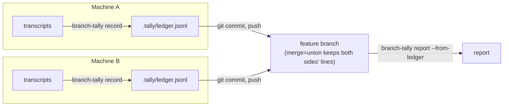

# Persisting the Ledger

By default `branch-tally report` reads Claude Code's transcripts live. That has limits:

- **Transcripts are purged.** Claude Code deletes them after `cleanupPeriodDays` (30 days by
  default). A branch that took longer than that, or a report run after the cleanup, comes up
  short.
- **Transcripts are local.** Work on a branch often happens on more than one machine. Each machine
  only sees its own sessions.
- **Worktrees come and go.** Subagent work in a git worktree is easiest to attribute while the
  worktree still exists.

The ledger fixes that. `branch-tally record` writes a branch's attributed usage to a file in the
repository, `.tally/ledger.jsonl`. You commit that file like any other. `branch-tally report
--from-ledger` then reports from it, with or without the transcripts.



## Set up your repository

Add this line to your repository's `.gitattributes`:

```text
.tally/ledger.jsonl merge=union
```

`merge=union` tells git to keep both sides' lines when two branches have each appended to the
ledger, instead of reporting a conflict. branch-tally does not add this line for you. Without it,
two branches that both recorded will conflict when merged.

If you use a different path with `--ledger`, put that path in `.gitattributes` instead.

If you commit the [hook captures](captures.md) file too, give it the same treatment:
`.tally/captures.jsonl merge=union`.

## Record

```sh
branch-tally record              # the current branch
branch-tally record feat/thing   # a named branch
```

`record` selects the branch's usage exactly as `report` would, then appends one line per API call
to the ledger:

```text
appended 3, skipped 0, branch feat/x
```

- **It only writes the file.** It does not `git add` or commit anything. Commit the ledger
  yourself.
- **It is safe to run again.** Each line is keyed by the API call's request id and the branch it
  was recorded for. `record` appends only keys the ledger does not hold yet, so a second run
  reports `appended 0, skipped 3`.
- **It creates the file** and the `.tally/` directory when they are missing.
- **It stores the mode.** `record` takes the same `--mode`, `--strict`, `--timeline` and
  `--work-branch` options as `report`, and the [config file](config.md)'s `mode` and
  `work-branch`. Each line stores the mode it was selected under.
- In claim mode, one API call can count toward two branches. It is then recorded once for each
  branch you record.

Run `record` on every machine that did work on the branch, **before** its transcripts are purged,
and while any worktrees the work used still exist. Then commit and push the ledger.

The full option list is in the [CLI reference](cli.md#branch-tally-record).

## Record automatically when a session ends

Remembering to run `record` before `cleanupPeriodDays` runs out is easy to get wrong. The optional
`branch-tally-record` Claude Code plugin does it for you: its `SessionEnd` hook runs
`branch-tally record` every time a session in the repository ends.

```text
/plugin marketplace add IAmSkweetis/branch-tally
/plugin install branch-tally-record@branch-tally
```

The hook records the branch the session's directory has checked out when the session ends, with
the `mode` and `work-branch` from your [config file](config.md). It is the same command as above,
so the same rules hold: it only writes the file, a second run appends nothing new, and you still
commit and push the ledger yourself. It needs `branch-tally` on your `PATH`, and it never blocks
the session, even when `record` fails.

Claude Code gives a `SessionEnd` hook 1.5 seconds by default, and a plugin can't raise that.
`record` reads every transcript for the repository, so a long history can need more. Set
`CLAUDE_CODE_SESSIONEND_HOOKS_TIMEOUT_MS` (in milliseconds) or use a hook in your own settings with
a `timeout`, as described in [SessionEnd time limit](integration.md#sessionend-time-limit). If
`record` is stopped part way, it catches up later: it appends only what the ledger does not already
hold, so the next session end, or a `record` by hand, writes the rest, provided it runs before the
transcripts are purged.

A branch worked on from several sessions, or with sessions that ended on another branch, may
still need a `record` by hand for the branches the hook did not see. Installing the plugin, and
the companion `branch-tally-capture` plugin, is covered in [Integration](integration.md).

## Report from the ledger

```sh
branch-tally report --from-ledger
branch-tally report --from-ledger --with-live
```

`--from-ledger` reports only from the ledger's lines recorded for the requested branch. It works
on a machine with no transcripts at all, such as a fresh clone. Every other `report` option still
applies: `--json`, `--pr`, `--redact` and the rest.

`--with-live` also reads this machine's live transcripts and combines them with the ledger. When a
call appears in both, the ledger's line is used, so nothing is counted twice. Use it when part of
the work is recorded and part is still only in local transcripts. `--with-live` without
`--from-ledger` is a command-line error (exit 2).

Prices are applied when you report, not when you record. The ledger stores token counts, so a
report from the ledger uses the price table in effect at report time.

What a ledger report tells you on stderr, as counts only:

| Note | Meaning |
| ---- | ------- |
| `note: unattributed counts unavailable from the ledger` | A live report can say how many calls in the repository could not be attributed to any branch. The ledger only holds the requested branch's calls, so it can't. |
| `note: ledger mixes modes (claim, timeline); the numbers combine them` | The branch was recorded under more than one attribution mode. |
| `note: skipped N ledger line(s): …` | Lines that were malformed or written by an unsupported ledger version were skipped and counted. |
| `note: N ledger request(s) had conflicting lines; kept the latest` | Two lines with the same key held different data. The one with the latest `recorded_at` is used. |

A duplicate line, such as one left by a union merge or by recording twice, is collapsed silently:
it is not a conflict.

If the ledger has no lines for the branch, `report --from-ledger` fails with
`No ledger records found for branch '…'` (exit 1). If the ledger file does not exist, it fails with
`no ledger at <path>` (exit 1).

## The whole project

`branch-tally project` reads the whole ledger and reports every recorded branch at once: the
project total, a row per branch, and a chart of cumulative cost over time. See
[Project Cost Over Time](project.md).

## Where the file lives

The default is `.tally/ledger.jsonl` at the root of the git checkout that contains the current
directory (or the `--repo` directory). Run from inside a git worktree, that is the worktree's own
root, so the ledger is committed on the worktree's branch and merges back with it.

`--ledger <path>` uses another file, on both `record` and `report --from-ledger`. Outside a git
checkout, `--ledger` is required: without it, `record` and `report --from-ledger` fail (exit 1)
rather than write a stray ledger.

`--ledger` only has an effect on `report` together with `--from-ledger`.

## What is stored

One JSON object per line, append-only. A line holds:

| Field | Holds |
| ----- | ----- |
| `v` | The ledger schema version, currently `1`. |
| `request_id` | The API call's request id. With `recorded_for`, the line's key. |
| `harness` | The agent harness, `claude-code`. |
| `session_id` | The Claude Code session id. |
| `agent_id` | The subagent's id, when a subagent made the call. |
| `ts` | The call's timestamp. |
| `model` | The model id. |
| `recorded_for` | The branch `record` was run for. |
| `mode` | The attribution mode: `claim`, `strict` or `timeline`. |
| `branch` | The branch attribution assigned to the call. |
| `basis` | How that branch was decided, such as stamped by the transcript, rolled up from a subagent's dispatcher, or `captured` from [hook captures](captures.md). |
| `kept_by` | Why the call was kept for the branch: its own branch matched, or its session was claimed. |
| `skill`, `agent` | The skill and named agent that made the call, if any. |
| `subagent` | The subagent's workspace and ids, for subagent calls. |
| `origin` | Where the session ran: `"main"` for the main checkout, or `{"worktree": "<name>"}` with the worktree's name relative to the repository. |
| `usage` | Token counts: input, 5-minute and 1-hour cache writes, cache reads, output and thinking. |
| `recorded_at` | When the line was written, in UTC. |

What is **never** stored: message content (prompts, responses, tool input or output, code), the
working directory, or any path. A worktree's transcript directory name encodes its full path,
including your user name, so the ledger keeps only the part after the main checkout's name. A
worktree outside the main checkout is stored without a name, and `record` says so:
`note: N record(s) from a worktree outside the main checkout were stored without a worktree name`.

### Redaction and the ledger

The ledger stores real identifiers: session ids, agent ids, skill and agent names and full
timestamps. `record` has no redaction option, and the config file's `redact` setting does not
apply to it. Anyone who can read the repository can read those identifiers.

`--redact` applies to report output, including a report from the ledger:
`branch-tally report --from-ledger --redact` hides the identifiers in what it prints, while the
file itself is unchanged.
