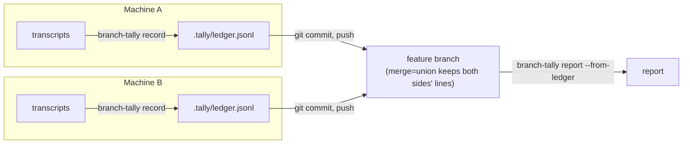

# Persisting the Ledger

By default `branch-tally report` reads Claude Code's transcripts live. That has limits:

- **Transcripts are purged.** Claude Code deletes them after `cleanupPeriodDays` (30 days by
  default). A branch that took longer than that, or a report run after the cleanup, comes up
  short.
- **Transcripts are local.** Work on a branch often happens on more than one machine. Each machine
  only sees its own sessions.
- **Worktrees come and go.** Subagent work in a git worktree is easiest to attribute while the
  worktree still exists.

The ledger fixes that. `branch-tally record` writes a branch's attributed usage to a file in the
repository, `.tally/ledger.jsonl`. You commit that file like any other. `branch-tally report
--from-ledger` then reports from it, with or without the transcripts.



## Set up your repository

### Opt the repository in

branch-tally never creates `.tally/`. `record` and the [hook captures](captures.md) write only when
the directory already exists as a real directory, so a repository opts in by having one. Create it
once, from the repository's root, and commit it:

```sh
mkdir .tally
touch .tally/.gitkeep
git add .tally/.gitkeep
git commit -m "chore: opt in to branch-tally"
```

Git does not track empty directories, which is what the `.gitkeep` is for. Once the ledger itself
is committed, it keeps the directory in place on its own.

Committing the directory matters because every clone and every git worktree gets its own copy of
it. A worktree, or a clone, whose checked-out commit has no `.tally/` is not opted in, and `record`
writes nothing there. [Hook captures](captures.md) always go to the main checkout's `.tally/`, so
the main checkout needs the directory too. A worktree that opted in on its own branch still
captures nothing while the main checkout is on a branch without `.tally/`. Commit the opt-in to the
default branch, so every branch cut from it has the directory.

Without the directory, `record` writes nothing, creates nothing, prints this on stdout and exits 0:

```text
no .tally/ directory: nothing recorded (create it to opt in)
```

`--ledger <path>` is exempt: an explicit ledger file is written whether or not `.tally/` exists.

### Keep both sides' lines on merge

Add this line to your repository's `.gitattributes`:

```text
.tally/ledger.jsonl merge=union
```

`merge=union` tells git to keep both sides' lines when two branches have each appended to the
ledger, instead of reporting a conflict. branch-tally does not add this line for you. Without it,
two branches that both recorded will conflict when merged.

If you use a different path with `--ledger`, put that path in `.gitattributes` instead.

If you commit the [hook captures](captures.md) file too, give it the same treatment:
`.tally/captures.jsonl merge=union`.

## Record

```sh
branch-tally record              # the current branch
branch-tally record feat/thing   # a named branch
```

`record` selects the branch's usage exactly as `report` would, then appends one line per API call
to the ledger:

```text
appended 3, skipped 0, branch feat/x
```

- **It only writes the file.** It does not `git add` or commit anything. Commit the ledger
  yourself.
- **It is safe to run again.** Each line is keyed by the API call's request id and the branch it
  was recorded for. `record` appends only keys the ledger does not hold yet, so a second run
  reports `appended 0, skipped 3`.
- **It creates the file, not the directory.** In an [opted-in](#opt-the-repository-in) repository
  it creates `ledger.jsonl` inside `.tally/` when the file is missing. It never creates `.tally/`
  itself.
- **It stores the mode.** `record` takes the same `--mode`, `--strict`, `--timeline` and
  `--work-branch` options as `report`, and the [config file](config.md)'s `mode` and
  `work-branch`. Each line stores the mode it was selected under.
- In claim mode, one API call can count toward two branches. It is then recorded once for each
  branch you record.

Run `record` on every machine that did work on the branch, **before** its transcripts are purged,
and while any worktrees the work used still exist. Then commit and push the ledger.

The full option list is in the [CLI reference](cli.md#branch-tally-record).

## Record automatically when a session ends

Remembering to run `record` before `cleanupPeriodDays` runs out is easy to get wrong. The optional
`branch-tally-record` Claude Code plugin does it for you: its `SessionEnd` hook runs
`branch-tally record` every time a session in the repository ends.

```text
/plugin marketplace add IAmSkweetis/branch-tally
/plugin install branch-tally-record@branch-tally
```

The hook records the branch the session's directory has checked out when the session ends, with
the `mode` and `work-branch` from your [config file](config.md). It is the same command as above,
so the same rules hold: it writes only in a repository that has
[opted in](#opt-the-repository-in), it only writes the file, a second run appends nothing new, and
you still commit and push the ledger yourself. Installing the plugin does not opt a repository in.
It needs `branch-tally` on your `PATH`, and it never blocks the session, even when `record` fails.

Claude Code gives a `SessionEnd` hook 1.5 seconds by default, and a plugin can't raise that.
`record` reads every transcript for the repository, so a long history can need more. Set
`CLAUDE_CODE_SESSIONEND_HOOKS_TIMEOUT_MS` (in milliseconds) or use a hook in your own settings with
a `timeout`, as described in
[SessionEnd time limit](integration/claude-code.md#sessionend-time-limit). If `record` is stopped
part way, it catches up later: it appends only what the ledger does not already hold, so the next
session end, or a `record` by hand, writes the rest, provided it runs before the transcripts are
purged.

A branch worked on from several sessions, or with sessions that ended on another branch, may
still need a `record` by hand for the branches the hook did not see. Installing the plugin, and
the companion `branch-tally-capture` plugin, is covered on the
[Claude Code integration](integration/claude-code.md) page.

## Report from the ledger

```sh
branch-tally report --from-ledger
branch-tally report --from-ledger --with-live
```

`--from-ledger` reports only from the ledger's lines recorded for the requested branch. It works
on a machine with no transcripts at all, such as a fresh clone. Every other `report` option still
applies: `--json`, `--pr`, `--redact` and the rest.

`--with-live` also reads this machine's live transcripts and combines them with the ledger. When a
call appears in both, the ledger's line is used, so nothing is counted twice. Use it when part of
the work is recorded and part is still only in local transcripts. `--with-live` without
`--from-ledger` is a command-line error (exit 2).

Prices are applied when you report, not when you record. The ledger stores token counts, so a
report from the ledger uses the price table in effect at report time.

What a ledger report tells you on stderr, as counts only:

| Note | Meaning |
| ---- | ------- |
| `note: unattributed counts unavailable from the ledger` | A live report can say how many calls in the repository could not be attributed to any branch: the [unstamped calls](cli.md#unstamped-calls) line (the JSON `unstamped` key) and the subagent section's unattributed counts. The ledger only holds the requested branch's calls, so it can't, and those counts are left out. With `--with-live` they come from the live transcripts and the note is not printed. |
| `note: ledger mixes modes (claim, timeline); the numbers combine them` | The branch was recorded under more than one attribution mode. |
| `note: skipped N ledger line(s): …` | Lines that were malformed or written by an unsupported ledger version were skipped and counted. |
| `note: N record(s) had an unreadable timestamp; they were kept but are undated` | Ledger lines whose `ts` is not strict RFC 3339 (see [Timestamps](cli.md#timestamps)). The lines are used and counted, but treated as having no timestamp. With `--with-live`, a separate line of the same form counts the live transcripts' records. |
| `note: N ledger request(s) had conflicting lines; kept the latest` | Printed only with `--allow-ledger-conflicts`. Two lines with the same key held different data, and the one with the latest `recorded_at` was used. See [Conflicting ledger lines](#conflicting-ledger-lines). |

A duplicate line, such as one left by a union merge or by recording twice, is collapsed silently:
it is not a conflict.

### Conflicting ledger lines

Each line is keyed by its `request_id` and `recorded_for`. A conflict is two lines with the same
key and different contents. It is unusual, because `record` skips a key the ledger already holds,
so it can mean a line was edited or added by hand. Which line wins decides what that call costs,
so by default a conflict stops the run. `report --from-ledger` and `project` exit with status 3 and
print a count, never a request id or line text:

```text
error: 1 ledger request(s) have conflicting lines, so the reported cost depends on which line wins. Inspect the ledger, or pass --allow-ledger-conflicts to proceed with the latest line for each
```

Look at the ledger's history (`git log -p -- .tally/ledger.jsonl`) to find out where the extra line
came from, and remove the wrong one. To report anyway, pass `--allow-ledger-conflicts`. The line
with the latest `recorded_at` is then used for each key, and the count is still printed on stderr
as `note: N ledger request(s) had conflicting lines; kept the latest`.

Exit 3 is separate from the general failure status, 1. A script that runs `report --from-ledger`
or `project` and tests only for exit 1 should test for any non-zero status instead.

If the ledger has no lines for the branch, `report --from-ledger` fails with
`No ledger records found for branch '…'` (exit 1). If the ledger file, or the `.tally/` directory,
does not exist, it fails with `no ledger at <path>` (exit 1). A linked default ledger is refused
(see [Symbolic links are refused](#symbolic-links-are-refused)).

## The whole project

`branch-tally project` reads the whole ledger and reports every recorded branch at once: the
project total, a row per branch, and a chart of cumulative cost over time. See
[Project Cost Over Time](project.md).

## Where the file lives

The default is `.tally/ledger.jsonl` at the root of the git checkout that contains the current
directory (or the `--repo` directory). Run from inside a git worktree, that is the worktree's own
root, so the ledger is committed on the worktree's branch and merges back with it. `record` writes
there only when that checkout has a `.tally/` directory: see
[Opt the repository in](#opt-the-repository-in).

`--ledger <path>` uses another file, on both `record` and `report --from-ledger`. Outside a git
checkout, `--ledger` is required: without it, `record` and `report --from-ledger` fail (exit 1)
rather than write a stray ledger.

`--ledger` only has an effect on `report` together with `--from-ledger`.

### Symbolic links are refused

`.tally/` is part of the repository, and git can store a symbolic link. A cloned repository could
therefore ship `.tally/ledger.jsonl`, or `.tally` itself, as a link to a file somewhere else on
your machine, and a hook that followed it would write there. So branch-tally does not follow links
in the default `.tally/` location, on read or on write.

The guard covers `.tally`, `.tally/ledger.jsonl`, `.tally/captures.jsonl` and `.tally/prices.toml`.
When one of them is a symbolic link, or is not the kind of file it should be (`.tally` must be a
directory, the others regular files), nothing is followed or created through it, and the command
fails with exit 1 and a message naming the path:

```text
refusing to use <path>: it is a symbolic link
refusing to use <path>: it is not a directory
refusing to use <path>: it does not resolve inside the main checkout
refusing to use <path>: it is not a regular file
```

The first three are about `.tally` itself: a link, a file, or a directory that resolves somewhere
other than the checkout. The last is for anything inside `.tally/` that is a link or not a regular
file. `record`, `report` and `project` print these. The captures hook and the price override print
their own messages instead, listed under [`capture`](cli.md#branch-tally-capture) and
[Which price table is used](cli.md#which-price-table-is-used). `report` and `project` read the
price override first, so a linked `.tally` stops them with the price table's message.

To fix it, replace the link with a real directory or file. An explicit `--ledger <path>` is your
own choice, so it is exempt: it is read and written as given, a link included. The guard still
applies to the captures file and the price override, which `--ledger` does not move.

## Checking ledger changes

The ledger is a plain text file in your repository. Nothing signs it, so anyone who can push a
commit can add, edit or remove lines, and a report from the ledger uses whatever it reads. The
same goes for `.tally/captures.jsonl`, which can move calls between branches, and for the
[price override](cli.md#which-price-table-is-used), which sets every cost. Review changes to
`.tally/` the way you review code. GitHub's `CODEOWNERS` file can require a named reviewer for
`.tally/**`.

`branch-tally ledger check` makes the mechanical part of that review automatic. Run it in CI on
each pull request. It passes only when the pull request appends to `.tally/ledger.jsonl` and
`.tally/captures.jsonl` and changes nothing already there, and when each new ledger line is not
recorded for the base branch, has a `recorded_at` that is not in the future, does not repeat a key
the base already holds, and has no token count above 10,000,000. The full rules and messages are in
the [CLI reference](cli.md#branch-tally-ledger-check).

A pull request may add lines for its own branch, and also for other branches, such as usage
backfilled for a branch that merged earlier. Each other branch gets a note on stderr:

```text
note: 2 new ledger line(s) recorded for branch docs/old
```

A note doesn't fail the check, but it is where to look first: those lines add to another branch's
cost. Lines recorded for the base branch always fail, because nothing should be merged as usage of
`main` itself. A pull request that changes `.tally/prices.toml` passes with a warning, which also
calls for a look by hand:

```text
warning: .tally/prices.toml differs from base
```

### Running it in CI

The check is only worth something if the pull request under review can't change it. If the branch
can edit the checker, the workflow or the build that runs them, it can switch the check off. So
run a binary built from your base branch, or a released one, never one built from the pull
request, and read the pull request's files as data.

On GitHub Actions, one way is a workflow on `pull_request_target`, which runs the base branch's
copy of the workflow:

1. Check out the base branch (the default for `pull_request_target`) and build or install
   branch-tally from it.
2. Fetch the pull request's merge commit as git data only. Don't check it out or run anything from
   it.
3. Check the merge commit against its first parent, naming both branches. `--head` reads the head's
   `.tally/` files from git, so the working tree, which holds the base branch, is not used:

```sh
git fetch --no-tags origin "+refs/pull/$PR_NUMBER/merge:refs/tally-check/merge"
head=$(git rev-parse --verify "refs/tally-check/merge^{commit}")
base=$(git rev-parse --verify "$head^1")
branch-tally ledger check --base "$base" --head "$head" \
  --head-branch "$HEAD_REF" --base-branch "$BASE_REF"
```

Here `PR_NUMBER`, `HEAD_REF` and `BASE_REF` come from the event
(`github.event.pull_request.number`, `.head.ref` and `.base.ref`). Pass them as environment
variables, not by pasting `${{ … }}` into the script. Using the merge commit's first parent as the
base, rather than the base branch's tip, keeps the comparison to exactly what the pull request
adds. GitHub doesn't create a merge commit for a pull request with conflicts, so the fetch fails
until they are resolved.

Pass `--head-branch` and `--base-branch` in CI. The current branch there is not the pull
request's: without `--head-branch`, a detached checkout exits 1, and a checkout of the base branch
reports the pull request's own lines as notes. A CI clone may also have no `origin/HEAD`, and then
the check exits 1 rather than guess the base branch. The output includes branch names taken from
the ledger, which the pull request controls. Notes escape a name that starts with `::`, and this
repository also wraps the whole output in a `::stop-commands::` block so nothing in it can act as a
workflow command.
[How this repository works](workflows/this-repository.md#checking-the-committed-lines) describes
its own job.

### What it can't tell

A line that passes is well-formed, not proven. The check can't tell a line `record` wrote from an
invented one that follows the rules. It narrows what a bad line can do: it can't edit lines already
merged, add usage to the base branch, or claim an impossible token count for one call. But many
plausible lines still add up, there is no limit on a pull request's total, and lines for other
branches are only noted. The reviewer still decides whether the new lines are plausible.

The price override is not checked, only flagged. Reports announce it on stderr too; see
[Which price table is used](cli.md#which-price-table-is-used).

## What is stored

One JSON object per line, append-only. A line holds:

| Field | Holds |
| ----- | ----- |
| `v` | The ledger schema version, currently `1`. |
| `request_id` | The API call's request id. With `recorded_for`, the line's key. |
| `harness` | The agent harness, `claude-code`. |
| `session_id` | The Claude Code session id. |
| `agent_id` | The subagent's id, when a subagent made the call. |
| `ts` | The call's timestamp, as the transcript recorded it. Left out when the transcript's timestamp is missing or not strict RFC 3339 (see [Timestamps](cli.md#timestamps)). |
| `model` | The model id. |
| `recorded_for` | The branch `record` was run for. |
| `mode` | The attribution mode: `claim`, `strict` or `timeline`. |
| `branch` | The branch attribution assigned to the call. |
| `basis` | How that branch was decided, such as stamped by the transcript, rolled up from a subagent's dispatcher, or `captured` from [hook captures](captures.md). |
| `kept_by` | Why the call was kept for the branch: its own branch matched, or its session was claimed. |
| `skill`, `agent` | The skill and named agent that made the call, if any. |
| `subagent` | The subagent's workspace and ids, for subagent calls. |
| `origin` | Where the session ran: `"main"` for the main checkout, or `{"worktree": "<name>"}` with the worktree's name relative to the repository. |
| `usage` | Token counts: input, 5-minute and 1-hour cache writes, cache reads, output and thinking. |
| `recorded_at` | When the line was written, in UTC. |

What is **never** stored: message content (prompts, responses, tool input or output, code), the
working directory, or any path. A worktree's transcript directory name encodes its full path,
including your user name, so the ledger keeps only the part after the main checkout's name. A
worktree outside the main checkout is stored without a name, and `record` says so:
`note: N record(s) from a worktree outside the main checkout were stored without a worktree name`.

### Redaction and the ledger

The ledger stores real identifiers: session ids, agent ids, skill and agent names and full
timestamps. `record` has no redaction option, and the config file's `redact` setting does not
apply to it. Anyone who can read the repository can read those identifiers.

`--redact` applies to report output, including a report from the ledger:
`branch-tally report --from-ledger --redact` hides the identifiers in what it prints, while the
file itself is unchanged.
