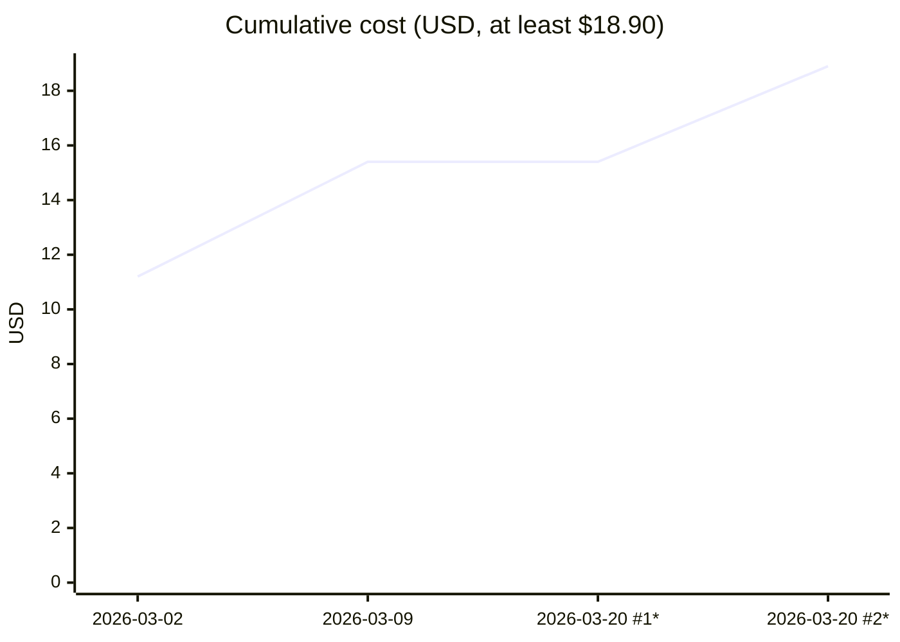

# Project Cost Over Time

`branch-tally report` answers "what did this branch cost?". `branch-tally project` answers "what
has the whole project cost so far, and how did it grow?". It reads the [ledger](ledger.md) and
prints:

- the **project total**: calls, tokens and estimated cost, with each API call counted once;
- a **per-branch table**: one row for each branch the ledger holds, with its last call date;
- **notes** on anything that makes a number uncertain;
- a **cost-over-time chart**: the cumulative cost, one point per branch, as a Mermaid block.

```sh
branch-tally project                                     # Markdown, from .tally/ledger.jsonl
branch-tally project --json                              # the same data as JSON
branch-tally project --export-graph docs/project-cost.svg   # also write the chart as SVG
```

The full option list is in the [CLI reference](cli.md#branch-tally-project).

## What it reads

`project` reads the ledger only. It never reads the live transcripts, so it works the same on a
fresh clone as on the machine that did the work. The default ledger is `.tally/ledger.jsonl` at the
root of the git checkout that holds the current directory, or the `--repo` directory. `--ledger
<PATH>` reads another file. A missing ledger is an error (`no ledger at <path>`, exit 1), not an
empty report, and so is a checkout with no `.tally/` directory. The default ledger is never read
through a symbolic link: a linked `.tally` or `.tally/ledger.jsonl` stops `project` with exit 1
(see [Symbolic links are refused](ledger.md#symbolic-links-are-refused)). A file named with
`--ledger` is read as given.

That makes the project total **the total of what was recorded**. A branch whose usage nobody ran
[`record`](ledger.md#record) for, or whose ledger lines were never committed and merged, is not in
it. Record every branch, on every machine that worked on it, if you want the total to cover the
whole project.

Prices are applied when you run `project`, from the price table for the `--repo` repository,
exactly as for `report --from-ledger`. See
[Which price table is used](cli.md#which-price-table-is-used).

The [config file](config.md)'s `mode` applies as it does to `report --from-ledger`. The branch of
each call was decided when it was recorded, so the mode doesn't move calls between branches or
change any number. In `strict` mode the report doesn't list the attribution heuristics.

The ledger notes that `report --from-ledger` prints on stderr (skipped lines, conflicting lines,
unreadable timestamps, mixed modes) are printed by `project` too. They are described in
[Report from the ledger](ledger.md#report-from-the-ledger). Like `report --from-ledger`, `project`
stops with exit 3 when the ledger has conflicting lines for one request, unless you pass
`--allow-ledger-conflicts`; see [Conflicting ledger lines](ledger.md#conflicting-ledger-lines).
When the price table is the repository's `.tally/prices.toml` override, `project` says so on
stderr.

## The per-branch table

There is one row for each branch that `record` was run for: the ledger's `recorded_for` field. A
row's numbers are what `branch-tally report <branch> --from-ledger` shows for that branch.

| Column | Holds |
| ------ | ----- |
| Branch | The branch `record` was run for. |
| Last call | The date of the latest API call in the branch's ledger lines, or `undated` when none of them has a usable timestamp. |
| Calls | API calls recorded for the branch, shared calls included. |
| Tokens | All tokens in those calls: input, cache writes, cache reads, output and thinking. |
| Cost | The estimated cost at list API rates, or `at least $X` when a model had no price. |

Rows are in order of their last call, oldest first. Timestamps are compared as points in time, so
a different time zone offset or precision doesn't change the order. Branches with the same last
call are ordered by name, and undated branches come last.

### Calls with no usable timestamp

A call whose timestamp is missing, or isn't strict RFC 3339 (see
[Timestamps](cli.md#timestamps)), is still counted in its branch's calls, tokens and cost. It just
can't date the branch:

- A branch where **no** call has a usable timestamp is **undated**. Its row says `undated`, and it
  is left off the chart (see [below](#the-cost-over-time-chart)).
- A dated branch with **some** such calls takes its date from the calls that have one. Its real
  last call may have been later than the date shown.

A note under the table names the dated branches this applies to:

```text
- 2 call(s) have no usable timestamp. These branches may end later than their last call shown,
  because those calls could not be dated: `fix/typo` (1 call(s))
```

(The real note is a single line; it is wrapped here to fit the page.) The first count is
project-wide, each call counted once, undated branches included. The list names only dated
branches, because an undated branch has no date to be early.

## Shared calls: why the rows can add up to more than the total

In claim mode, one API call can count toward two branches: for example, a session that started on
one feature branch and moved to another. `record` then writes the call once for each branch it
was recorded for (see [Record](ledger.md#record)).

`project` keeps both views honest:

- each **row** counts every call recorded for its branch, shared calls included, so the row
  matches that branch's own report;
- the **project total** counts each API call once, however many branches claim it.

So the rows can sum to more than the total. When that happens, a note under the table says by how
much:

```text
- Shared calls: 1 call(s) (3,240,000 tokens, $3.50) were counted more than once in the rows
  because two or more branches claim them. The project total counts each once, so the rows may
  sum to more than the total.
```

(The real note is a single line; it is wrapped here to fit the page.) In JSON, the same figures
are in `overlap`.

## Floors: "at least $X"

A cost that leaves something out is shown as a floor, a lower bound, never as an exact figure:

- A **row** is `at least $X` when one of its models has no price in the price table. Its tokens
  are counted, but the unpriced model's cost is not in `$X`. A branch that used only unpriced
  models shows `at least $0.00`: its tokens are real, but nothing in them could be priced. A
  row is also `at least $X` when its totals overflowed (see [below](#overflowed-totals)).
- The **project total** is `at least $X` when any figure in the report is a floor: the total, any
  row or any chart point. A note names the unpriced models.

To make a floor exact, give the model a price: run `branch-tally prices update` if the model is
newer than your price table, or add it to a `.tally/prices.toml` override in the main checkout's
`.tally/` directory, as a regular file, not a link. See
[Which price table is used](cli.md#which-price-table-is-used).

Token counts can be floors too. When some calls could not be placed on a branch with certainty, a
note says how many, and that "Token totals are at least what is shown". In JSON,
`totalTokensIsFloor` is `true`.

When attribution heuristics such as session claim or dispatcher roll-up assigned calls to a
branch, a note lists each one with its call and token counts. Those calls are counted, but their
branch was inferred rather than stamped. The heuristics are described in
[Attribution modes](cli.md#attribution-modes).

### Overflowed totals

A token or call count can't grow past 18,446,744,073,709,551,615, the largest value branch-tally
holds. A ledger line can claim any number, so a sum can reach that limit. branch-tally then stops
it at the limit and marks the report unreliable, as `report` does (see
[Overflowed totals](cli.md#overflowed-totals)):

- The Markdown report puts this statement under the total line, before the table:

  ```text
  **Totals overflowed and are unreliable**: a token or call count exceeded the largest value the
  tool can hold, so every total here is at least what is shown and the real figure is unknown.
  ```

  (The real statement is a single line; it is wrapped here to fit the page.)
- The project total reads `at least $X`, and so does the cost of each branch whose own total
  overflowed. The chart's title says "at least", and from the first overflowed branch on, its
  points are floors, marked `*`.
- In JSON, `totalsOverflowed` is `true` at the top level, and on each branch whose own total
  overflowed. `totalTokensIsFloor` and `totalCostIsFloor` are `true`, and so is the overflowed
  branches' `costIsFloor`.
- The SVG adds the footer line `totals overflowed, unreliable`, and its heading says "at least".

One overflowed branch is enough to mark the whole report, because the project total includes it.
The line under the Markdown chart that explains `*` names the cause, looking only at the dated
branches the chart is built from:

- "has an unpriced model" when no dated branch's own total overflowed;
- "has totals overflowed, unreliable" when one did, and no dated branch has an unpriced model;
- "has an unpriced model and totals overflowed, unreliable" when both are true.

For example:

```text
Points marked * are floors: that branch or an earlier one has totals overflowed, unreliable, so the real cost is at least this.
```

A total that large means some ledger line claims far more tokens than a real API call uses. Find
it in the ledger's history before trusting any figure in the report.
[`ledger check`](ledger.md#checking-ledger-changes) rejects new lines with a token field above
10,000,000, so [running it in CI](ledger.md#running-it-in-ci) on each pull request keeps such a line
out of the ledger.

## The cost-over-time chart

The chart has one point per dated branch, in the same order as the table. Each point's height is
the cumulative cost: that branch's cost plus every earlier branch's. Its label is the branch's
last call date. The chart shows dates only; branch names are in the table.

When two or more points fall on the same day, each of them gets an ordinal after the date, so the
labels stay distinct: `"2026-03-20 #1"`, `"2026-03-20 #2"`. A date that occurs once has no
ordinal.

A shared call is added once, at the earliest branch that claims it. So the chart never counts a
call twice, and its last point is the total cost of all the dated branches.

The chart's title gives that last point: `Cumulative cost (USD)` when it is exact, or
`Cumulative cost (USD, at least $X)`, where `$X` is the last point, when it is not. It says "at
least" when any figure in the report is a floor, or when some branch is undated.

Two things the chart leaves out, and says so:

- **Undated branches.** A branch with no usable timestamp has no place on a time axis. It is in
  the table and the total, but not on the chart. The chart then covers the dated branches only, so
  its last point is lower than the project total, and the title says "at least". A note under the
  table says how many branches were left off.
- **The scale of time.** Points are evenly spaced in date order. The distance between two points
  does not show how much time passed between them.

**Floor points.** Once a branch is a floor, every point from there on is a floor too, because each
point includes every earlier branch. The Markdown chart puts `*` at the end of a floor point's
label, after any ordinal (`"2026-03-20 #1*"`), and adds a line under the chart explaining the `*`.
The SVG draws a floor point as a hollow circle, with a dashed segment leading into it.

## Example

The output below comes from a small synthetic ledger, made up for this page. It has five
branches:

- `fix/typo` shares one call with `feat/login`, and has one call with no timestamp;
- `docs/faq` used only a model with no price, on the same day as `feat/search`;
- `feat/search` used that model too, alongside a priced one;
- `chore/old-notes` has no timestamps at all.

````markdown
## Project cost

Project total: **at least $22.40** · 10 call(s) · 32,400,000 tokens (32.4M)

| Branch | Last call | Calls | Tokens | Cost |
| --- | --- | ---: | ---: | ---: |
| `feat/login` | 2026-03-02 | 4 | 12,960,000 | $11.20 |
| `fix/typo` | 2026-03-09 | 3 | 9,720,000 | $7.70 |
| `docs/faq` | 2026-03-20 | 1 | 3,240,000 | at least $0.00 |
| `feat/search` | 2026-03-20 | 2 | 6,480,000 | at least $3.50 |
| `chore/old-notes` | undated | 1 | 3,240,000 | $3.50 |

- Shared calls: 1 call(s) (3,240,000 tokens, $3.50) were counted more than once in the rows because two or more branches claim them. The project total counts each once, so the rows may sum to more than the total.
- 1 model(s) unpriced, total is a floor: `claude-mystery-9`
- Attributed by heuristic: session claim 1 call(s) / 3,240,000 tokens
- 1 branch(es) have no timestamp and are left off the chart, which covers dated branches only and so shows at least the cost of those.
- 2 call(s) have no usable timestamp. These branches may end later than their last call shown, because those calls could not be dated: `fix/typo` (1 call(s))



Points marked * are floors: that branch or an earlier one has an unpriced model, so the real cost is at least this.
````

The Mermaid block renders like this:


Reading it:

- The rows sum to $25.90 and 11 calls. The total is $22.40 and 10 calls, because the shared call
  is counted once.
- The total is "at least", because `docs/faq` and `feat/search` used `claude-mystery-9`, which
  has no price. `docs/faq` used nothing else, so its row is `at least $0.00`.
- `fix/typo` adds $4.20 to the chart, not its row's $7.70, because its shared call ($3.50) was
  already counted at `feat/login`. One of its calls has no timestamp, so its work may have ended
  after 2026-03-09.
- `docs/faq` and `feat/search` both last ran on 2026-03-20, so their labels get `#1` and `#2`.
  Both are floors, so both carry `*`. `docs/faq` adds nothing that could be priced, so the line
  stays flat into it.
- The chart ends at $18.90, not $22.40: `chore/old-notes` ($3.50) is undated, so it is in the
  total but not on the chart. The title says "at least" for that reason as well as for the floor.

## Output formats

### Markdown

Markdown (`--format md`) is the default. It is the `## Project cost` section shown above: the
total line, the table, the notes and the Mermaid `xychart-beta` block. The total line always
shows the full project total, each call counted once, undated branches included. With no branches
in the ledger, it says `No branches recorded in the ledger.` With no dated branches, it prints the
table and says `No dated branches, so there is no cost chart.`

The output holds branch names, dates, model ids and numbers only. `project` has no redaction
option: branch names appear in the table as they are in the ledger.

### JSON

`--json` (or `--format json`) prints one object on stdout:

| Key | Holds |
| --- | ----- |
| `totalCalls` | API calls in the project, each counted once. |
| `totalTokens` | Their tokens, each call counted once. |
| `totalTokensIsFloor` | `true` when some calls could not be placed with certainty, or a total overflowed, so token totals are a lower bound. |
| `totalsOverflowed` | `true` when a token or call total overflowed, in the project total or any branch, so every total is an unreliable floor (see [Overflowed totals](#overflowed-totals)). Absent otherwise. |
| `totalCostUSD` | The estimated project cost in US dollars, each call counted once. |
| `totalCostIsFloor` | `true` when any figure in the report is a floor: the total, a branch or a series point. |
| `unpricedModels` | Model ids that had no price, across all branches. |
| `overlap` | The shared calls: `calls`, `tokens`, `costUSD` and `costIsFloor`. Counted in more than one branch, once in the totals. |
| `heuristics` | Calls and tokens per attribution heuristic, and `ambiguous`, as in `report`'s JSON, plus `isFloor`. Every key is present, with zeros where nothing applied. |
| `undatedBranches` | How many branches have no usable timestamp and are left off the series. |
| `undatedCalls` | How many calls have no usable timestamp, each counted once, undated branches included. |
| `branches` | One object per branch, in table order: `branch`, `lastCall` (the full timestamp as recorded, or `null`), `calls`, `tokens`, `costUSD`, `costIsFloor`, `unpricedModels`, `heuristics` and `undatedCalls` (this branch's calls with no usable timestamp), plus `totalsOverflowed: true` when this branch's own total overflowed. |
| `series` | One object per chart point, in date order: `date` (the full timestamp), `branch`, `cumulativeCostUSD` and `isFloor`. |

Dollar amounts are rounded to four decimal places. An all-unpriced branch has `"costUSD": 0.0`
with `"costIsFloor": true`, the JSON form of `at least $0.00`. An abridged example from the
synthetic ledger above, with some branches and points and every `heuristics` object left out:

```json
{
  "totalCalls": 10,
  "totalTokens": 32400000,
  "totalTokensIsFloor": false,
  "totalCostUSD": 22.4,
  "totalCostIsFloor": true,
  "unpricedModels": ["claude-mystery-9"],
  "overlap": { "calls": 1, "tokens": 3240000, "costUSD": 3.5, "costIsFloor": false },
  "undatedBranches": 1,
  "undatedCalls": 2,
  "branches": [
    { "branch": "fix/typo", "lastCall": "2026-03-09T09:00:00Z", "calls": 3, "tokens": 9720000, "costUSD": 7.7, "costIsFloor": false, "unpricedModels": [], "undatedCalls": 1 },
    { "branch": "docs/faq", "lastCall": "2026-03-20T09:00:00Z", "calls": 1, "tokens": 3240000, "costUSD": 0.0, "costIsFloor": true, "unpricedModels": ["claude-mystery-9"], "undatedCalls": 0 },
    { "branch": "chore/old-notes", "lastCall": null, "calls": 1, "tokens": 3240000, "costUSD": 3.5, "costIsFloor": false, "unpricedModels": [], "undatedCalls": 1 }
  ],
  "series": [
    { "date": "2026-03-02T13:00:00Z", "branch": "feat/login", "cumulativeCostUSD": 11.2, "isFloor": false },
    { "date": "2026-03-20T16:00:00Z", "branch": "feat/search", "cumulativeCostUSD": 18.9, "isFloor": true }
  ]
}
```

### SVG

`--export-graph <PATH>` also writes the chart as a standalone SVG file, 640 by 360 pixels. When
more than two footer notes apply, the image grows 16 pixels taller for each extra note, so none is
cut off. The report still prints on stdout as usual, in whichever format you chose.

- The heading, which is also the SVG's `<title>`, gives the last plotted point:
  `Cumulative cost: $X`, or `Cumulative cost: at least $X` when any figure in the report is a
  floor (an overflowed total included) or some branch is undated. As in the Markdown chart, `$X`
  covers the dated branches only.
- The axis shows the first and last dates. A floor point is a hollow circle, and the segment
  leading into it is dashed.
- Lines under the chart explain what it can't show: `hollow = floor (at least), dashed line leads
  to a floor` when there is a floor, `totals overflowed, unreliable` when a total overflowed (see
  [Overflowed totals](#overflowed-totals)), `N undated branch(es) not shown`, and
  `N call(s) with no usable timestamp, branch dates may be early`. Each appears only when it
  applies.
- Branch names are not printed on the chart. Each point has a tooltip with its branch, date and
  cumulative cost. Browsers don't show tooltips for an SVG embedded as an image, so open the file
  itself to see them.
- The colours follow the viewer's light or dark colour-scheme preference, so the chart stays
  readable on both. The file loads nothing from the network.

The file is written whole or not at all: a failed write leaves any existing file as it was. An
existing file at `PATH` is replaced. The parent directory must already exist. If the file can't be
written, `project` prints `cannot write graph <path>: <error>` on stderr, prints no report, and
exits 1.

## Put the chart in your README

`project` only writes files you name, and commits nothing. To show the chart in your repository's
README, write it to a file in the repository and commit it with the ledger.

**As an SVG image.** Write the chart, discarding the report:

```sh
mkdir -p docs
branch-tally project --export-graph docs/project-cost.svg > /dev/null
```

Then reference it from `README.md`:

```markdown

```

Re-run the command, and commit the new file, whenever the ledger changes.

**As a Mermaid block.** GitHub renders Mermaid in Markdown, so you can paste the chart block into
the README instead. On Linux and macOS, this prints just the block:

```sh
branch-tally project | sed -n '/^```mermaid$/,/^```$/p'
```

If the chart has floor points, paste the line explaining `*` along with it, so a reader knows
those points are lower bounds.
