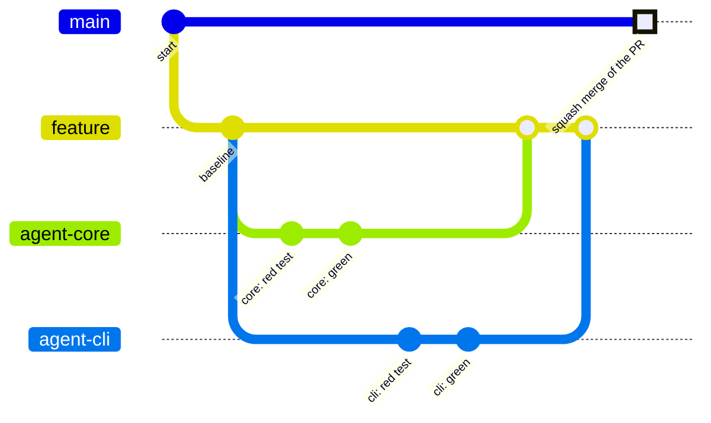
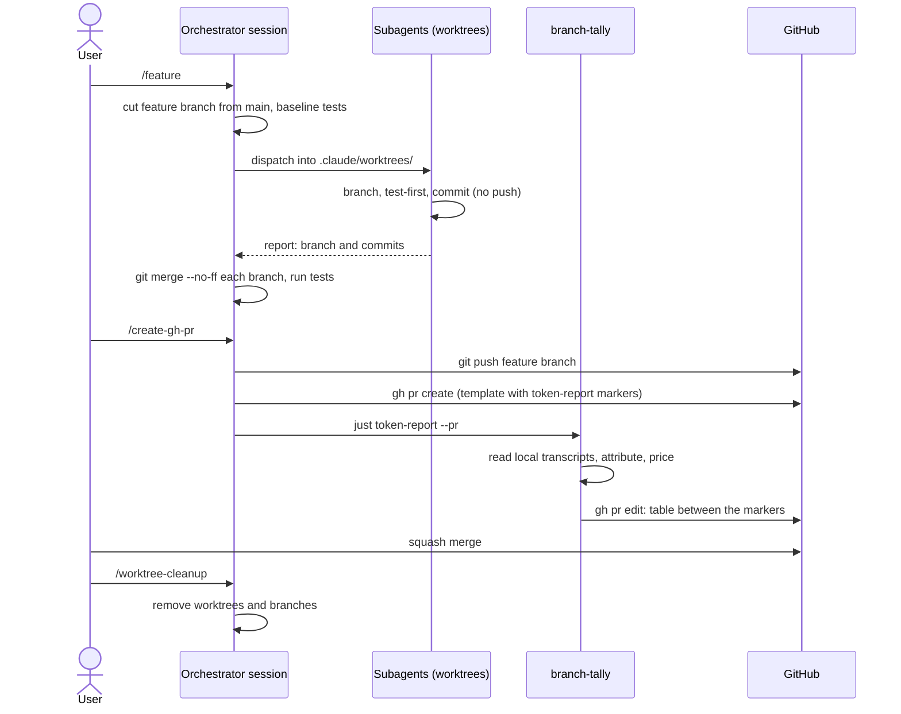

# This repository

branch-tally is built with Claude Code, and every pull request in its repository reports its own
token cost with branch-tally. This page describes that workflow as the repository runs it today.
The procedures live in the repository's Claude Code skills (`.claude/skills/feature/`,
`.claude/skills/create-gh-pr/` and `.claude/skills/worktree-cleanup/`) and in its
[pull request template](https://github.com/IAmSkweetis/branch-tally/blob/main/.github/PULL_REQUEST_TEMPLATE.md).

## The shape of the work

One Claude Code session, the **orchestrator**, runs in the repository's main checkout. It does
not write the feature itself. It:

1. interviews the user about the issue, then cuts a short-lived feature branch from an up-to-date
   `main`, named per Conventional Branch (for example `feat/issue-4-report-command`), and runs the
   test suite for a baseline;
2. dispatches specialized subagents, each into its own git worktree under `.claude/worktrees/`.
   The repository sets Claude Code's `worktree.baseRef` to `head`, so each worktree starts from the
   orchestrator's current commit;
3. each subagent cuts its own branch in its worktree, commits there, and never pushes. It hands
   back a structured report naming its branch and commits;
4. merges each subagent's branch into the feature branch with `git merge --no-ff` as it lands, and
   runs the test suite after every merge;
5. hands the merged branch to the user to try on real transcripts (dogfooding), and leaves every
   worktree in place until the pull request has merged.



In the diagram, `feature` is the feature branch and `agent-core` and `agent-cli` are two
subagents' branches. Two agents working on disjoint parts run at the same time. The last commit
on `main` stands for the squash merge: the pull request lands as **one new commit** whose message
is the PR title, and none of the branch's own commits become part of `main`'s history.

## Why the numbers come out right

The subagents' transcripts are written under the main checkout's transcript directory, inside the
orchestrator's session, and stamped with the orchestrator's branch or with a throwaway
`worktree-agent-…` branch. They are never stamped with the branch the subagent cut. In the default
claim mode, branch-tally:

- assigns each subagent's calls to the branch the orchestrator was on when it dispatched that
  subagent (*dispatcher roll-up*);
- resolves `worktree-agent-…` stamps through `git worktree list` (*worktree recovery*), which only
  works while the worktree still exists.

That second point is why the report is published before any worktree is removed. The report's
footnote lists both heuristics with the calls and tokens each one assigned.

## Publishing the report

When the work is merged into the feature branch and the full gate (`just ci`) is green, the user
runs `/create-gh-pr`. That skill:

1. checks the branch is not `main`, `gh` is signed in, the tree is clean and `main` has not moved;
2. pushes the feature branch (only the feature branch, never a subagent's);
3. opens the pull request with `gh pr create`. The body starts from the PR template, whose last
   section is:

   ```markdown
   ## Token usage

   <!-- token-report:start -->
   _Not yet recorded._
   <!-- token-report:end -->
   ```

4. runs the token report straight away, while every worktree still exists:

   ```sh
   just token-report --pr
   ```

   That recipe runs `branch-tally report --pr` with the **installed release binary**, not a build
   of the branch under review, so the number comes from a published release. branch-tally finds the
   branch's open PR and replaces the placeholder between the markers with the table.

The skill states the result as a floor ("at least $X"). It must run on the machine that did the
work, within Claude Code's transcript retention period, from sessions whose working directory was
this repository.



## Merging and cleaning up

The pull request is squash-merged, the only merge method the repository allows. Its title is a
Conventional Commit and becomes the commit message on `main`.

Only after the merge does the user run `/worktree-cleanup`. It refuses to start until the PR is
merged, and it checks the PR body: if the text between the `token-report` markers still says
`_Not yet recorded._`, it asks whether to run the report **before** removing anything. Because a
squash merge leaves none of a branch's commits in `main`'s history, it decides whether each branch
landed by comparing content, not ancestry, and only then removes the worktrees and branches.

## The ledger

This repository does not commit a [ledger](../ledger.md) yet. Its reports are read from the live
transcripts on the machine that did the work, at the moment the PR is opened, which is why the
order above matters: report first, clean up after. A repository that needs the numbers to survive
transcript cleanup, or to combine work from several machines, can run `branch-tally record` and
commit `.tally/ledger.jsonl` instead, as described in [Persisting the Ledger](../ledger.md).
