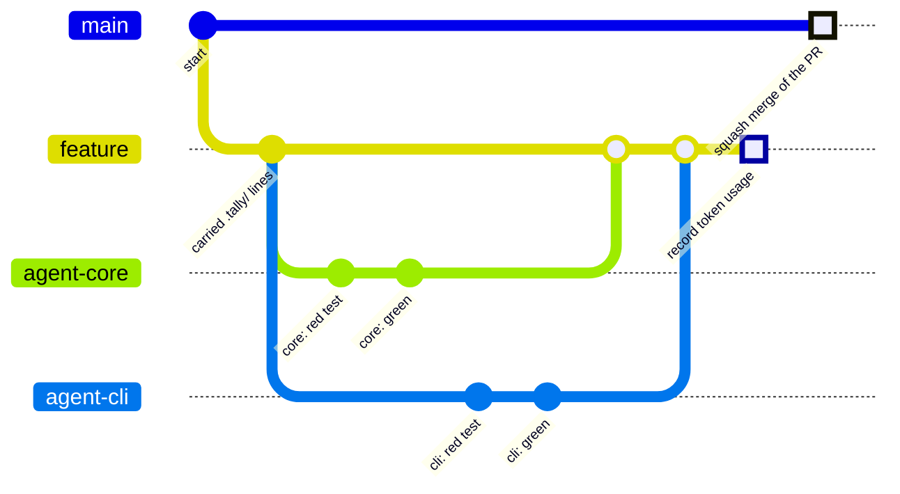
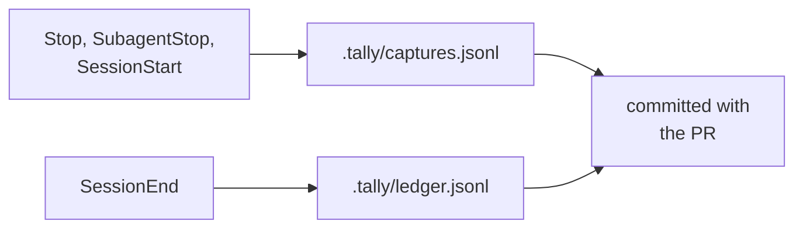
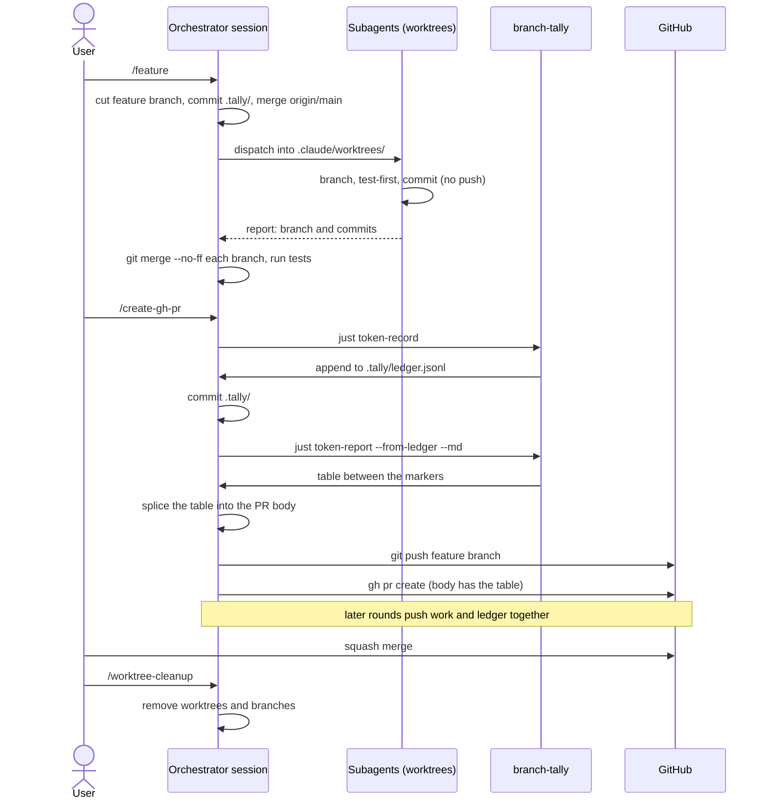

# This repository

branch-tally is built with Claude Code, and every pull request in its repository reports its own
token cost with branch-tally. This page describes that workflow as the repository runs it today.
The procedures live in the repository's Claude Code skills (`.claude/skills/feature/`,
`.claude/skills/create-gh-pr/` and `.claude/skills/worktree-cleanup/`), its `justfile` and its
[pull request template](https://github.com/IAmSkweetis/branch-tally/blob/main/.github/PULL_REQUEST_TEMPLATE.md).

Both [Claude Code plugins](../integration/claude-code.md) run in the repository, and the
[ledger](../ledger.md) is committed with each pull request. A PR's token report is published from
that committed ledger, not straight from the transcripts.

## The shape of the work

One Claude Code session, the **orchestrator**, runs in the repository's main checkout. It does
not write the feature itself. It:

1. interviews the user about the issue, then cuts a short-lived feature branch named per
   Conventional Branch (for example `feat/issue-4-report-command`). If the hooks have appended
   lines to `.tally/` since the last pull request, it commits them on the new branch. It then
   merges `origin/main` into the branch and runs the test suite for a baseline;
2. dispatches specialized subagents, each into its own git worktree under `.claude/worktrees/`.
   The repository sets Claude Code's `worktree.baseRef` to `head`, so each worktree starts from the
   orchestrator's current commit;
3. each subagent cuts its own branch in its worktree, commits there, and never pushes. It hands
   back a structured report naming its branch and commits;
4. merges each subagent's branch into the feature branch with `git merge --no-ff` as it lands, and
   runs the test suite after every merge;
5. hands the merged branch to the user to try on real transcripts (dogfooding), and leaves every
   worktree in place until the pull request has merged.

Before the branch is first pushed, it gains one more commit: the ledger lines that record what
the branch cost (see [Publishing the report](#publishing-the-report)).



In the diagram, `feature` is the feature branch and `agent-core` and `agent-cli` are two
subagents' branches. Two agents working on disjoint parts run at the same time. The first commit
on `feature` appears only when there were `.tally/` lines to carry over. The `record token usage`
commit adds the branch's ledger lines. The last commit on `main` stands for the squash merge: the
pull request lands as **one new commit** whose message is the PR title, and none of the branch's
own commits become part of `main`'s history. The ledger lines arrive on `main` inside it.

## The hooks and the ledger

The repository's `.claude/settings.json` declares this repository as the `branch-tally` plugin
marketplace and enables both plugins, `branch-tally-capture` and `branch-tally-record`, in the way
[shown on the Claude Code page](../integration/claude-code.md#for-everyone-who-works-in-a-repository).
Every session started in the repository therefore runs them:



- The capture hooks append to `.tally/captures.jsonl` in the main checkout, including captures
  from sessions in a worktree. See [Hook captures](../captures.md).
- When the orchestrator's session ends, the record hook appends the usage of the branch the main
  checkout has checked out to `.tally/ledger.jsonl` there.

Both files are committed. Committing them is also what keeps the repository
[opted in](../ledger.md#opt-the-repository-in): the hooks write only into a `.tally/` directory
that already exists, and because `.tally/` is in every commit, the main checkout and every
subagent's worktree have one. The repository's `.gitattributes` gives both files `merge=union`, so
lines that two branches each appended merge without a conflict:

```text
.tally/ledger.jsonl merge=union
.tally/captures.jsonl merge=union
```

The hooks write the files but never commit them, and they write on whatever branch is checked
out. So the main checkout often has uncommitted `.tally/` lines, and the skills plan for that:
their clean-tree checks ignore `.tally/` (`git status --short -- . ':!.tally'`), and the lines are
committed on the next feature branch, never on `main` and never discarded.

### Checking the committed lines

Because the ledger sets the number every PR publishes, changes to `.tally/` are checked on every
pull request:

- The **`tally-check`** job, in its own workflow (`.github/workflows/tally-check.yml`), runs on
  `pull_request_target` for every pull request. That trigger runs the **base branch's** copy of
  the workflow, so the job checks out the base branch, builds the checker from it, and fetches the
  PR's merge commit (`refs/pull/<N>/merge`) as git data only. No PR code is checked out, built or
  run, so a PR that changes the checker, the workflow or the build can't switch off its own check.
  It follows the recipe in [Running it in CI](../ledger.md#running-it-in-ci): the merge commit is
  the head, its first parent is the base, and the PR's head and base branches are passed as
  `--head-branch` and `--base-branch`.
- When the PR changes nothing under `.tally/`, the job passes with a notice. Otherwise it runs
  [`branch-tally ledger check`](../cli.md#branch-tally-ledger-check). The PR may only append to the
  ledger and captures files, and no new ledger line may be recorded for the PR's base branch,
  normally `main`.
  Lines for any other branch pass, and each such branch is named in a notice. A change to
  `.tally/prices.toml` passes with a warning. The checker's output is printed inside a
  `::stop-commands::` block, so text from the ledger can't run workflow commands, and its
  `warning:` and `note:` lines are repeated as annotations on the run.
- A PR with merge conflicts has no merge commit to read, so the job fails until they are resolved.
- The job checks that lines are well-formed, not that they record real work, and it has no limit
  on how much a PR adds in total. Review covers that.
- The PR that first added the workflow did not run it, because its base branch didn't have the
  workflow yet. Every later PR does.
- `.github/CODEOWNERS` names a reviewer for `.tally/**`.

Leftover lines recorded for `main` are the case to watch. When a session ends while the main
checkout has `main` checked out, the record hook can append lines recorded for `main`, and they are
committed on the next feature branch with the rest of the uncommitted `.tally/` lines.
`tally-check` fails that PR, and merging it anyway needs an administrator to bypass the check.
Leftover or backfilled lines for any other branch pass, each branch with a notice.

## Why the numbers come out right

The subagents' transcripts are written under the main checkout's transcript directory, inside the
orchestrator's session, and stamped with the orchestrator's branch or with a throwaway
`worktree-agent-…` branch. They are never stamped with the branch the subagent cut. In the default
claim mode, branch-tally:

- assigns each subagent's calls to the branch the orchestrator was on when it dispatched that
  subagent (*dispatcher roll-up*);
- resolves `worktree-agent-…` stamps through `git worktree list` (*worktree recovery*), which only
  works while the worktree still exists;
- places a session's own calls that carry no usable stamp from the [hook captures](../captures.md),
  when captures on both sides of the call agree on the branch.

That is why the usage is recorded before any worktree is removed. `record` attributes each call
when it runs and stores the branch, and how that branch was decided, in the ledger line. A report
from the ledger keeps those answers after the worktrees and transcripts are gone. Its footnote
lists the heuristics used, with the calls and tokens each one assigned.

## Publishing the report

When the work is merged into the feature branch and the full gate (`just ci`) is green, the user
runs `/create-gh-pr`. The skill records the branch's usage **before the branch is first pushed**,
so the pull request opens with its table already in the body. That skill:

1. checks the branch is not `main`, `gh` is signed in, the tree is clean apart from `.tally/`, and
   `main` has not moved. It doesn't push yet;
2. records the branch's usage, commits the ledger and renders the report from it, straight away,
   while every worktree still exists:

   ```sh
   just token-record                    # branch-tally record
   git add .tally/ledger.jsonl          # and .tally/captures.jsonl, if it changed
   git commit -m "chore: record token usage for this branch"
   just token-report --from-ledger --md > <tmp>/report.md   # branch-tally report --from-ledger --md
   ```

   `<tmp>` is a directory outside the repository. Both recipes run the **installed release
   binary**, not a build of the branch under review, so the number comes from a published release.
   When `record` appends nothing, the skill skips the commit. No pull request is needed yet:
   `record` attributes by branch, and `report --from-ledger` prints the table to stdout between
   the `token-report` markers;
3. writes the PR body from the PR template, whose last section is:

   ```markdown
   ## Token usage

   <!-- token-report:start -->
   _Not yet recorded._
   <!-- token-report:end -->
   ```

   and, once the user confirms the title and body, replaces the placeholder with the table:

   ```sh
   uv run scripts/splice_token_report.py <body-file> <tmp>/report.md
   ```

   The script exits non-zero and leaves the body untouched when either file lacks the markers, as
   it does when the ledger has no lines for the branch. The skill then leaves the placeholder in
   place and reports why. Under the markers it adds one line, which a later `report --pr` leaves
   alone:

   ```markdown
   _Recorded before review: usage from later rounds is not included, so this is a floor._
   ```

4. pushes the feature branch (only the feature branch, never a subagent's) and opens the pull
   request with the finished body:

   ```sh
   git push -u origin <branch>
   gh pr create --title "<title>" --body-file <body-file> --label "<kind>"
   ```

The skill reads the total as printed. It says "at least $X" when some calls could not be
attributed with certainty or a model has no price. A report from the ledger also prints
`note: unattributed counts unavailable from the ledger` on stderr, because the ledger holds only
this branch's calls, so the report can't include the line counting the repository's
[unstamped calls](../cli.md#unstamped-calls). A ledger that is missing lines can understate the
total without the "at least" label, so an unlabelled number is not presented as complete.

`record` must run on the machine that did the work, within Claude Code's transcript retention
period, from sessions whose working directory was this repository.

### Why the usage is recorded before the first push

Every push to an open pull request starts its checks again, and the repository's ruleset, which
requires one approving review, dismisses that approval on every push. Recording after the pull
request is open would mean a push that holds only `.tally/` lines. That push re-runs every check
for no change to the code, and it throws away an approval that a reviewer has no reason to give
again: an automated reviewer can skip a commit that only touches `.tally/`, and then the approval
never returns. Recording first means no push to a pull request is ever only token usage, whichever
reviewer the repository uses.

The cost is completeness. The table covers the branch up to the commit that recorded it, not the
rounds that follow, which is why the body says the number is a floor.

### Later rounds

Review fixes, a merge of a moved `main`, or any other work after the pull request opens records
that round's usage and commits it **with the round's work**, in the same push:

```sh
just token-record
git add .tally/ledger.jsonl            # if record changed it
git commit -m "chore: record token usage for this branch"
git push                               # one push: the round's work and its ledger lines
just token-report --pr --from-ledger   # optional: refresh the table in the PR body
```

`report --pr --from-ledger` finds the branch's one open pull request in the `origin` repository
and replaces what sits between the markers. That edits the body, not the branch, and an edit
doesn't cancel the checks a push started: only the PR-title check runs on an edited pull request,
in its own workflow. The last round's own usage is still missing from the table, so the floor line
stays.



## Merging and cleaning up

The pull request is squash-merged, the only merge method the repository allows. Its title is a
Conventional Commit and becomes the commit message on `main`. The branch's ledger lines land on
`main` with it, so `main`'s ledger holds every merged branch.

Only after the merge does the user run `/worktree-cleanup`. It refuses to start until the PR is
merged, and it checks the PR body: if the text between the `token-report` markers still says
`_Not yet recorded._`, it asks whether to run the report **before** removing anything. Because a
squash merge leaves none of a branch's commits in `main`'s history, it decides whether each branch
landed by comparing content, not ancestry, and only then removes the worktrees and branches.

Finally it checks out `main` and fast-forwards it to `origin/main`. If uncommitted `.tally/` lines
stop the fast-forward, it leaves `main` behind and the lines uncommitted, and says so. The next
`/feature` commits them on its new branch and merges `origin/main` there.

## The project chart

The README's cost-over-time chart, `docs/assets/project-cost.svg`, comes from the committed
ledger. `just readme-graph` regenerates it with the installed release binary:

```sh
branch-tally project --export-graph docs/assets/project-cost.svg
```

It is run by hand and the result committed. The chart covers what was recorded: a branch whose
lines never reached `main`'s ledger is not in it. See [Project Cost Over Time](../project.md).
